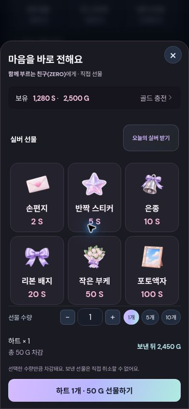
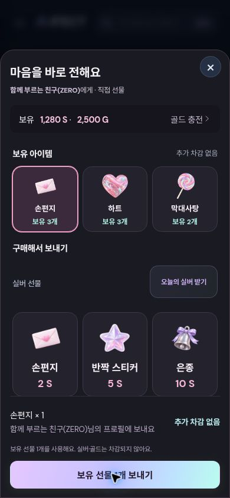
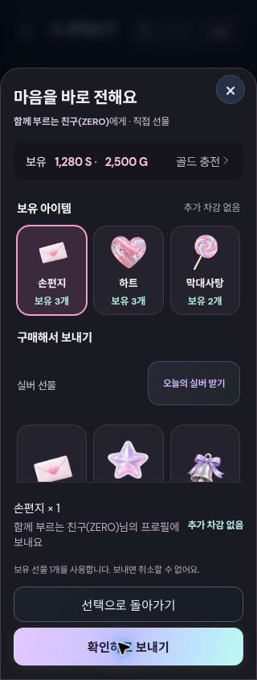
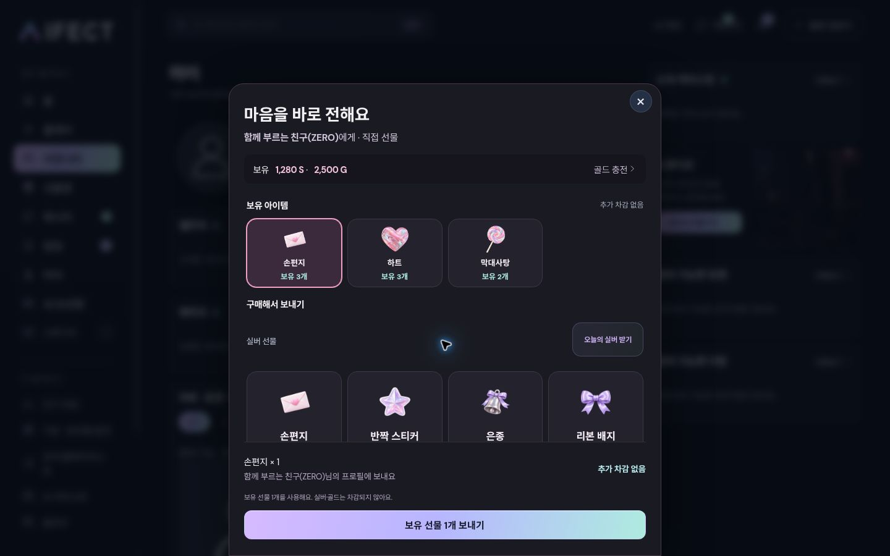

# 웹 선물창 보유 아이템 연결

상대방에게 선물할 때 이미 산 선물이 표시되지 않아 같은 선물을 다시 구매하게 되는 문제를 수정했다. 공통 선물창의 목록 맨 위에 보유 아이템과 수량을 표시하고, 그 아래 기존 실버·골드 구매 목록을 유지한다.

보유 선물은 하나를 선택하고 받는 사람·사용 수량·추가 차감 없음을 확인한 뒤 기존 `/api/me/gift-inventory/:id/send`로 보낸다. 구매 전송 API와 구분하며 서버의 기존 소유권·결제 상태·중복 처리 검증을 유지한다. 통신 실패 후 재시도에는 같은 request_id를 사용한다. 창을 다시 열면 보유 수량을 새로 조회한다. 목록 조회 실패는 빈 보유함으로 오인하지 않도록 재시도를 제공한다.

곡 화면에서 보유 아이템을 쓰는 경우에는 해당 창작자의 **프로필에 보내는 선물**임을 명시한다. 기존 곡 선물 구매는 그대로 `/api/tracks/:id/gifts`로 처리한다. 보유 선물 API는 곡별 전송을 지원하지 않으므로 해당 의미를 임의로 바꾸지 않았다.

프로필 더보기 버튼이 delegated handler의 중첩 버튼 제외 조건에 걸려 열리지 않던 문제를 수정했다. 프로필 팝업에 선물 보내기 버튼을 연결했다. 기존 로고·색상·가격·선물 이미지·메뉴·정산 정책은 유지한다. 런타임 서버와 DB migration 변경은 없다.

## 검증

- `node --test tests/gift-recipient-inventory.test.mjs`: 8개 통과. 실제 Worker + 로컬 SQLite를 사용해 구매 후 보유량, 응답 유실 후 재시도, 추가 차감 없음, 직접 구매 전환, 조회 오류/비회원/사용 불가, 계정 변경, 곡/프로필 전송 구분, 연속 클릭을 검증했다.
- `npm run lint:play`, `npm run typecheck:play`: 기존 프로젝트 검사 통과. 이 검사 범위는 기존 play 모듈이며 신규 gift JS는 구문 검사·실행 테스트·빌드로 검증했다.
- `npm run release:prepare`: 144개 테스트 파일, 857개 중 855개 통과 / 2개 기존 건너뛰기 / 실패 0, 빌드 통과. 업로드 직전 release:check로 동일 소스/산출물을 확인한다.
- Sites 공식 관리 미리보기에서 실제 앱을 iframe viewport 320×844, 390×844, 768×844, 1440×900으로 렌더링했다. 이전 PC 캡처는 1440×900 iframe 아래에 브라우저 여백이 포함되어 있다.
- 모바일 프로필 → 더보기 → 선물 → 보유 아이템 확인 → 전송 → 재진입 시 수량 3→2 갱신, 실버/골드 잔액 불변을 확인했다. 구매 목록 전환 시 5개/10 S 합계도 확인했다. 320px 확인/취소 버튼은 뷰포트 안에 표시되고 전송 버튼 높이는 47px이다.
- 테스트는 `tests/preview-integrated.mjs`의 분리된 메모리 SQLite 데이터로 진행했다. 운영 계정 선물·결제·구매는 실행하지 않았다. 미리보기용 포트/호스트 인자, HTTP 개발 환경 UUID 보완, responsive iframe 경로는 테스트 파일에만 존재하며 배포 Worker/클라이언트에 포함되지 않는다.
- 실기기 웹 브라우저의 최종 운영 검증은 신규 후보 배포 후 수행해야 한다.

## 화면 기록

## 앞선 지갑 내역 배포

사용자가 승인한 version 221 / commit `598042fe928e0d5c762ae2ff7e0ee8eba668aefc`는 공식 배포 `appgdep_6ade242b09388191bd328d6beb699bc7`로 성공했다. 실제 aifect.co.kr의 클라이언트, 익명 MCP 차단, 인증된 관리자 읽기 도구를 확인했고 `/api/gold/history?currency=silver|gold`는 비회원 요청에 모두 401을 반환한다(이전 404 해소). 신규 웹 선물 UI 수정은 별도 후보로 저장하며 221에 포함되었다고 주장하지 않는다.
