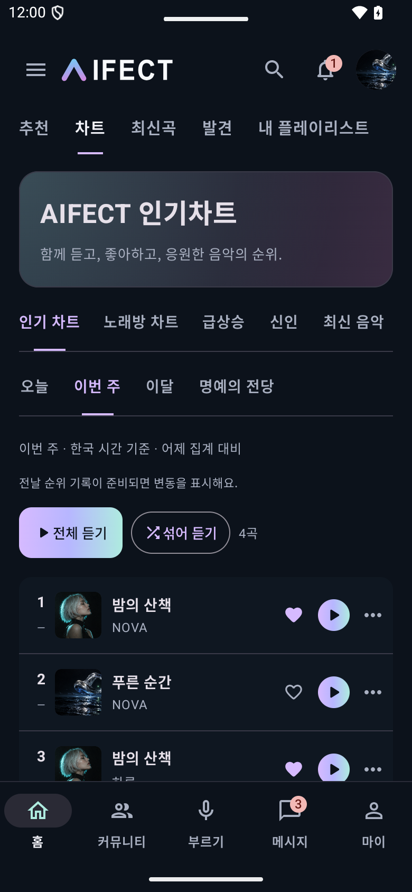
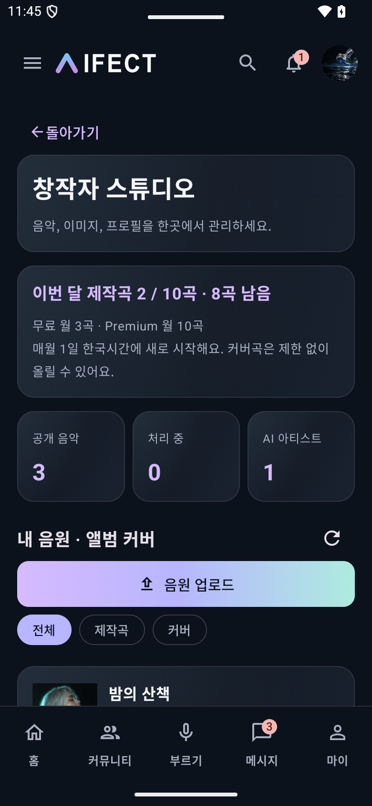
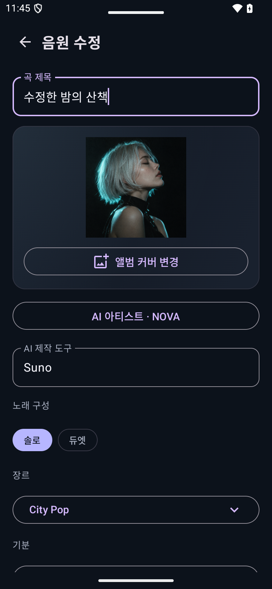
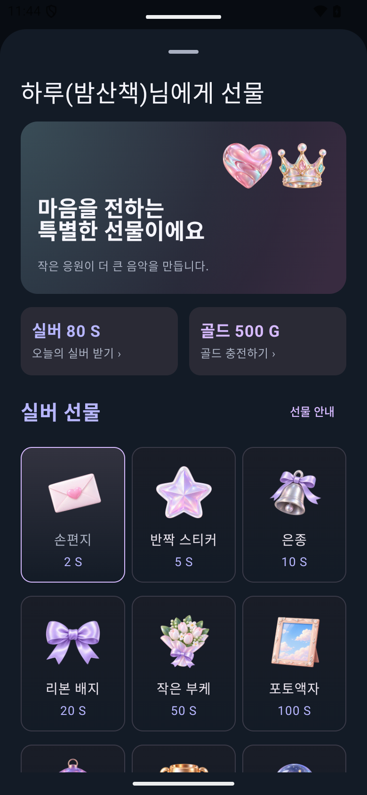
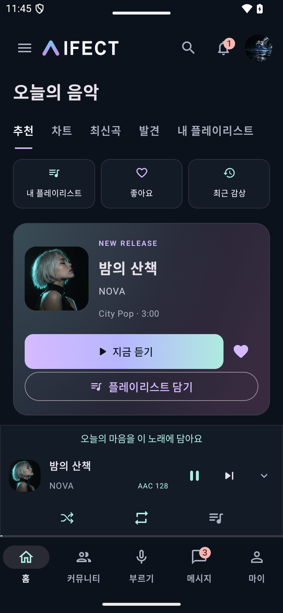

# Android 2.5.50 (63) — 모바일 웹 비교, 스튜디오 및 인기 차트 수정

2026-10-17. 기준은 운영 웹 v153이다. 웹 소스를 번들에 복사하는 방식이 아니라 Kotlin Compose/Java 네이티브 화면을 수정했다. 웹 서버와 가격·정산 정책에는 변경이 없다.

## 2.5.50 차트 추가 수정

- 5곡짜리 인기곡 미리보기 패널을 제거하고 모바일 웹처럼 순위·앨범·곡명/아티스트·좋아요·재생·더보기가 이어지는 목록으로 교체했다. 앨범은 모서리 6dp인 사각형, 사용자 프로필은 기존 원형이다.
- 오늘/이번 주/이달/명예의 전당은 웹과 동일한 `/api/catalog?section=tracks&chart=top&period=…`를 사용한다. 서버 순위와 전날 비교가 있는 경우에만 실제 상승/하락/신규를 표시한다.
- 급상승/신인/최신 음악을 연결하고 노래방 차트는 기존 실제 커버 랭킹으로 연다. 전체/섞어 듣기, 곡별 담기·선물·댓글 메뉴를 제공한다.
- 차트 관련 기기 검사 3개 통과: 화면 및 노래방 연결, 긴 곡명 무손실 줄바꿈과 행 비겹침, 이달 요청·서버 순위·더보기→댓글 이동. 앨범 모서리 최종 조정 뒤 화면 검사를 다시 수행했다.

## 설치 결과

Galaxy Z Flip6 (SM-F761N)에 기존 직접 설치본과 같은 인증서로 `adb install -r` 업데이트했다. 설치된 버전 2.5.49 / 62와 앱의 정상 시작(Status: ok)을 확인했다. 앱 삭제·데이터 초기화는 수행하지 않았다. 2.5.49 설치 후 차트 피드백을 반영한 2.5.50(63)도 같은 방식으로 업데이트 완료했다. 기기에서 versionCode=63 / versionName=2.5.50, 정상 시작(Status: ok, 714ms)을 확인했다. Play Console에는 제출하지 않았다.

## 비교 후 반영

| 영역 | 반영 내용 | 확인 |
| --- | --- | --- |
| 스튜디오 | 외부 브라우저 이동을 없애고 앱 로그인으로 목록/월 한도/업로드/원곡 정보·앨범 이미지·가사/MR/아티스트 편집 제공 | 마이·계정 메뉴 진입, 제목·소개 저장, 이미지 PUT, 파일 선택→초안 생성→음원 전송→제출 검사 |
| 업로드 | 무료 월 3곡·Premium 월 10곡 서버 한도, 최대 80MiB, 권리·AI·MR 동의, 알려진 초안 ID로 재시도 | 격리된 파일 선택기 결과와 실제 요청 본문/바이트 길이 확인 |
| 메인 메뉴 | 전체 메뉴, 네이티브 공개 플레이리스트/AI 아티스트 목록, 차트/발견/보관함/아이템/정산 연결 | 주요 메뉴 이동과 복귀 검사 |
| 홈·커뮤니티 | 웹과 같은 라벤더/민트 버튼, 홈 바로가기·대표곡 버튼 배치, 커뮤니티 배너 아래 탭과 피드, 중복 재생/담기 줄 정리 | 390dp 에뮬레이터 캡처와 390px 모바일 웹 캡처 비교 |
| 선물·알림 | 하트/왕관 배너·3열 실버/골드 이미지, 잔액과 충전, 상세 안내 분리, 알림 목록 높이 확보 | 수량 5→합계 10S→확인→요청값, 날짜/보낸 사람/선물/읽음 검사 |
| 크루 | 서버 can_rename 기준 30일 제한과 변경 가능 날짜, 다른 사람 프로필에서 초대 DM 발송, DM의 크루 링크 | 제한 중 이름 잠금·소개 수정 유지, 초대 요청 ID/DM/크루 이동 검사 |
| 플레이어·녹음 | 한 줄 가사·셔플·반복·큐·접기 유지, 미니플레이어 패널 색, 녹음 설정/재생 컨트롤 색상 | 가사 한 줄 및 버튼 상태 검사, Java 녹음 코드 빌드 |

원곡과 커버의 편집 권한은 구분된다. 커버는 소개만 수정하며 이미지는 업로더 프로필을 따른다. 비공개 원곡의 스튜디오 미리보기는 인증된 이미지 요청을 사용하고 디스크에 저장하지 않는다. 편집 화면에서는 다른 메뉴로 빠져 업로드를 중단하지 않도록 상·하단 탐색을 숨긴다.

## 검증 결과와 범위

- release APK/AAB 생성 및 린트 성공. JVM 테스트 61개 통과, 린트 0 errors / 116 warnings.
- `DesignCaptureTest`의 관련 시나리오 9개가 최종적으로 모두 통과했다: 스튜디오 진입/저장, 커버 편집/이미지 전송, 신규 업로드, 전체 메뉴, 크루 초대, 이름 변경 제한, 주요 화면, 선물/알림, 미니플레이어.
- 첫 테스트에서 계정 메뉴와 배경의 동명 버튼 선택이 모호해 전용 testTag로 수정했다. 파일 선택기 테스트는 ActivityMonitor로 격리했고, 알림 검사는 데이터가 도착한 뒤 진행하도록 고쳤다. 실제 알림 화면도 충분한 높이를 확보했다.
- 모든 변경·선물·DM 테스트는 별도 패키지 `kr.co.aifect.app.test`와 로컬 서버를 사용했다. 운영 계정의 음원/선물/메시지를 수정하지 않았다.
- 실기기에서 설치 버전과 실행은 확인했지만 운영 계정으로 유료 결제·선물 전송·공개 업로드를 실행하지는 않았다. MR 재처리 및 AI 가사 작업의 서버 완료, 사람 목소리 품질, 모든 화면의 픽셀 단위 일치를 주장하지 않는다.
- iOS는 별도 구현/빌드가 필요하다. 푸시 미구현 메모와 웹 변경사항은 `IOS-HANDOFF-20261017.md`에 유지한다.

## 캡처

아래는 운영 사용자 데이터가 아닌 에뮬레이터 테스트 데이터다.

## 산출물

휴대폰 설치 파일: `AIFECT-2.5.49-62-phone.apk` (로컬 산출물, Git 제외).

SHA-256: `8943c3fa775ffa4331fd8d845c2c913c290cb79090a96b40586ade17fc9fe630`

## 화면 축소 관련 확인

사용자가 첨부한 웹 크루 페이지를 읽기 전용으로 점검했다. 크루 이미지 원본 967×946, 표시 크기 90×150 / 94×118 / 36×36. 이미지 보간은 auto, 검사한 글자 transform은 none이다. XP 등 작은 문자는 9.17~10.56px로, 브라우저 축소 시 가독성이 낮아질 수 있다. 사용자 질문에 원본 손상이 아닌 작은 표시 크기 영향임을 설명하고 100% 비교를 안내했다. 이번 Android 작업에서 웹 CSS를 변경하거나 운영 웹을 새로 배포하지 않았다.

최종 휴대폰 설치 파일: `AIFECT-2.5.50-63-phone.apk`. SHA-256: `69474479e6884eec4788418bbff5b5637e303f4e4fe5cfb3845edc7fe00cdf34`. release APK/AAB·린트 재검증 성공, JVM 61개 실패 0. 최종 패키징은 Gradle의 일시적인 IncrementalSplitterRunnable 오류 후 재시도하여 성공했다.
