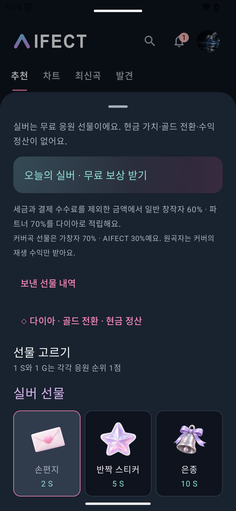
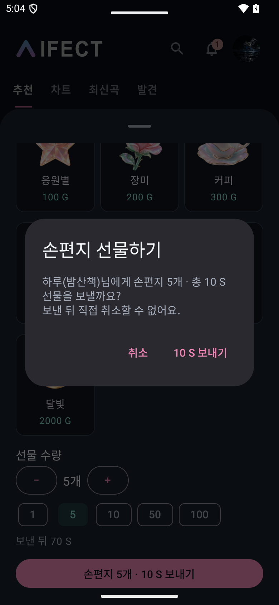
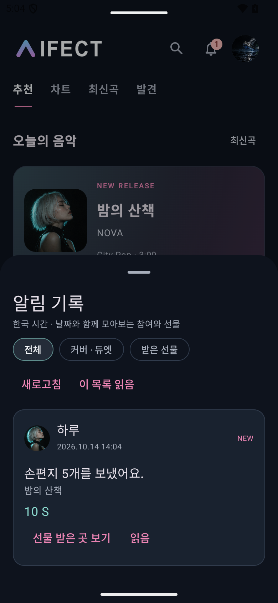
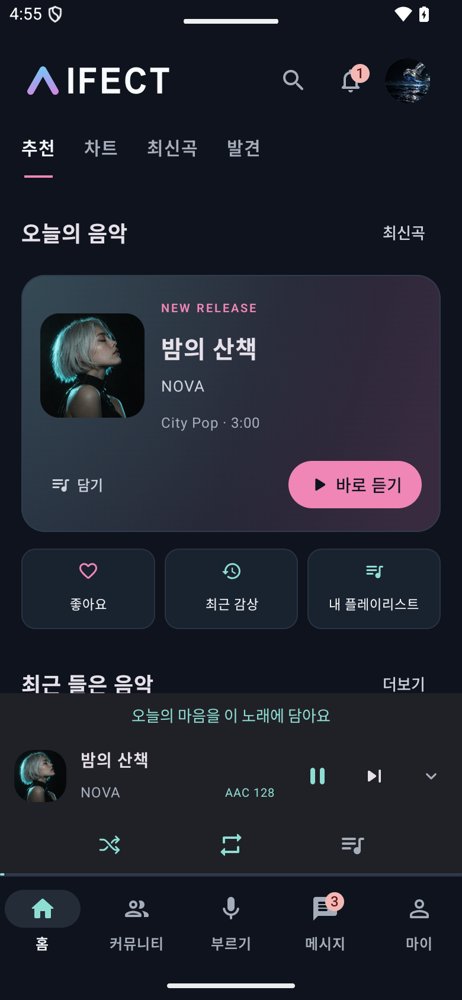
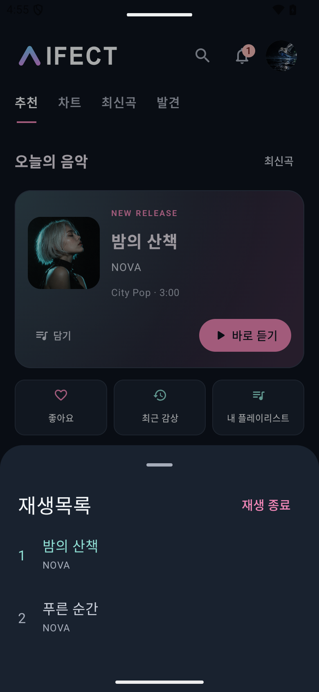
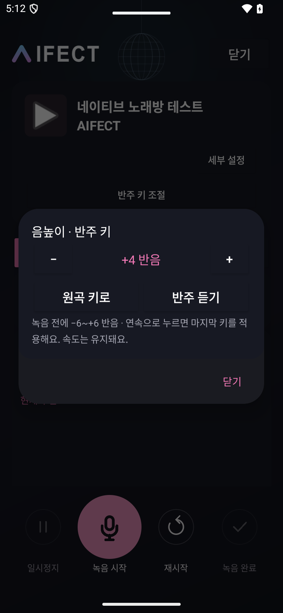
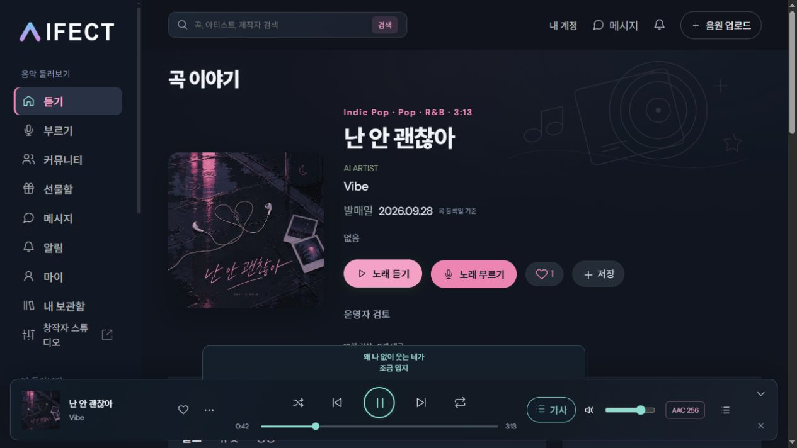
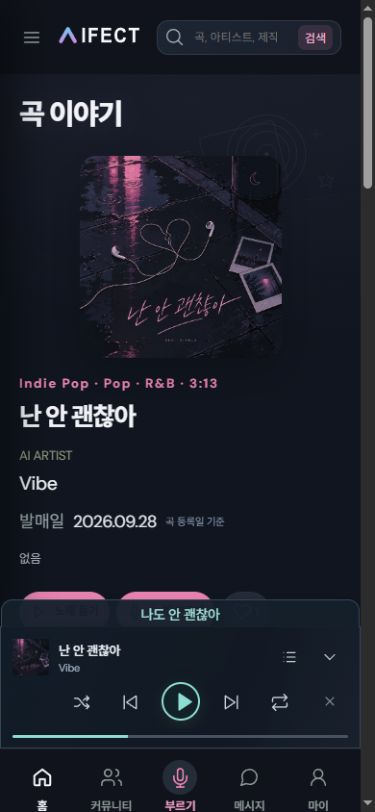

# AIFECT web / Android handoff — 2026-10-17

Android 2.5.47 (versionCode 60) was submitted to the existing Google Play **비공테** closed-testing track. Review is pending; submission does not mean the update is already available to testers. iOS has not been built or submitted from this Windows checkout.

## Current source

- Branch: `codex/android-native-app`.
- `ai음원사이트/` contains the deployed web application, assets, APIs, schema and migrations through Sites source commit `15a5bb7992210a4210854be6e7c2e72a8663a8cc` (production version 151).
- The mirror preserves its own hosting/Git configuration. Do not overwrite production settings or replay migrations without checking the target environment.
- Production: https://aifect.co.kr

## iPhone implementation reference

- New crew management: owner name changes have a server-enforced 30-day cooldown. Public person profiles in web now offer **내 크루에 초대**, sending an ordinary DM via `POST /api/dm/:profileId/crew-invite` with `crew_id` and stable `request_id`, then opening the conversation. Native implementation details and validation are in [`CREW-MANAGEMENT-20261017.md`](../../ai음원사이트/docs/CREW-MANAGEMENT-20261017.md). Native app controls for these additions still need implementation/build on the respective platform.
- Desktop web lyric banner now fits the two text lines rather than spanning half the screen; mobile web remains one line. Google and Naver ownership verification and sitemap registration are complete; preserve both tags in `dist/index.html` (see [`SEARCH-REGISTRATION-20261017.md`](../../ai음원사이트/docs/SEARCH-REGISTRATION-20261017.md)).

- Gift catalog matches the confirmed web design: 9 silver gifts / 10 gold gifts. Display **실버 / 골드**, units **S / G**. Quantity 1–100, total cost, balance confirmation and duplicate-request protection are implemented in Android `GiftSelection.kt`, `GiftScreens.kt` and the web gift APIs.
- Activity notifications show who participated in a cover/duet or sent a gift, with date, quantity and total. The entry is available under Messages, after the pinned crew conversation, plus the profile and header notification badge. See `ActivityScreens.kt` and `/api/notifications` in the mirrored server.
- Cover artwork uses the uploader's profile; originals retain their registered album artwork. Original-song cover tabs are solo, duet and ranking by actual views.
- Owners can change original album artwork and playlist artwork. My page shows silver/gold balances and a creator-studio entry.
- Original-song upload allowance is free **3 per month**, Premium **10 per month**. Existing pricing, diamond settlement and crew/player-frame policies are retained.
- Home, community, genre images and compact song lists follow the updated web design. Community cards do not include decorative waveform bars.
- Android compact player has the current lyric, shuffle, repeat, playback controls, queue and collapse. Detailed gift/save/sing/comment actions stay in the song view.
- **The latest lyric request specifically concerns mobile web:** desktop web defaults to two lyric lines, mobile web to one. The desktop lyric toggle remains available. Screenshots below are from the deployed site, at desktop and 390px mobile viewport sizes.
- Solo recording uses white for the current line and gray for other lines. Duet parts retain three roles/colors and manual line assignment. Pitch correction is removed from the user flow; vocal tone/effect controls remain.
- Android backing-track key changes allow repeated taps without waiting for each intermediate conversion: the most recent selection wins. Key range is -6 to +6 semitones with tempo retained; selection survives activity recreation. Existing duet participation inherits the source key. `karaoke/BackingKey.java` and `KaraokeActivity.java` provide the implementation reference.

## 공통 디자인 후속 작업 (2026-10-17)

사용자가 제공한 디자인 시스템에 맞춰 **웹·모바일 웹**을 라벤더 `#B7B6FF`, 연보라 `#D6BAFF`, 민트 `#AEEBDF`, 어두운 남색 패널과 1.6px 선 아이콘으로 변경했다. 버튼·탭·메뉴의 선택 상태, 입력창, 재생바, 녹음 설정까지 적용했다. 색상/범위/검증 상세는 [`DESIGN-SYSTEM-20261017.md`](../../ai음원사이트/docs/DESIGN-SYSTEM-20261017.md)를 기준으로 한다.

- [ ] iOS 공통 테마에 위 색상, 그라데이션, 아이콘 선 두께, 흰 슬라이더 핸들을 적용하고 실기기에서 확인.
- [ ] 네이티브 Android에도 같은 기준을 적용할 후속 빌드 필요. 기존에 제출한 2.5.47(60)에는 이번 새 웹 테마가 들어 있지 않다.
- 솔로/듀엣 가사 역할 색, 오류·성공 색, 원형 프로필·액자, 선물 이미지의 의미를 유지한다.
- 웹 실화면: [데스크톱](theme-20261017/web-desktop.png), [모바일 웹](theme-20261017/web-mobile.png).

## iPhone 후속 작업: 푸시 알림 누락 (2026-10-17)

사용자 제보: 현재 아이폰 앱에는 푸시 알림 기능이 보이지 않음. **Mac에서 이어서 구현·확인할 미완료 항목**으로 기록한다. 앱 안의 알림 기록 화면과 별도로, 앱이 백그라운드에 있거나 종료된 상태에서도 알림을 받을 수 있어야 한다. 이 메모를 추가한 시점에는 iOS 구현이나 실기기 검증을 진행하지 않았다.

- [ ] iOS 알림 권한 요청, 기기 토큰 등록·갱신, 서버 푸시 전송 연결을 점검하고 누락된 부분 구현.
- [ ] 개인 DM·크루 채팅, 내 곡의 커버·듀엣 참여, 받은 선물 알림을 연결. 채팅 알림 끄기 설정을 존중.
- [ ] 알림을 누르면 해당 대화·곡·알림 기록으로 이동하고 읽음 상태와 배지를 맞춤.
- [ ] 로그아웃·계정 전환 시 기기 토큰 연결을 정리해 이전 계정의 알림이 오지 않도록 확인.
- [ ] 실제 아이폰에서 포그라운드·백그라운드·종료 상태의 수신과 알림 거절·다시 허용 흐름을 검증한 후 완료 처리.

## Validation and limitations

- Release build and signed AAB verification succeeded.
- 61 release unit tests passed. Device checks cover gift quantity/cost, activity history, images/cover tabs, mini-player/queue, and recording-key behavior. Two failures in the initial device run were fixed and both passed on rerun; the final rapid-key/activity-recreation check also passed.
- Backing-key tests verify expected pitch changes, unchanged duration/source samples and cancellation cleanup. Human vocal quality was not assessed by these automated tests.
- Android release lint: 0 errors, 116 warnings. Existing warnings are not a claim of a warning-free project.
- Web focused tests: 31 passed; final public-catalog artwork correction: 2 passed. The mirrored files are copied from that validated source.
- AdSense rejection reason was **가치가 별로 없는 콘텐츠**. Public music/catalog/detail/about content and navigation were improved, deployed, and resubmitted. Approval remains pending.

## Build artifact

- `AIFECT-2.5.47-60-play.aab`
- SHA-256: `7F1B611EDE368EC41C8EB75D31DF42113DD7CA8E68DC5EDFA31EA9838822B5ED`
- The signed binary and signing credentials are not committed. Google Play has the submitted bundle.

## Screens

Android screenshots below use isolated emulator fixtures, not production users or transactions.

