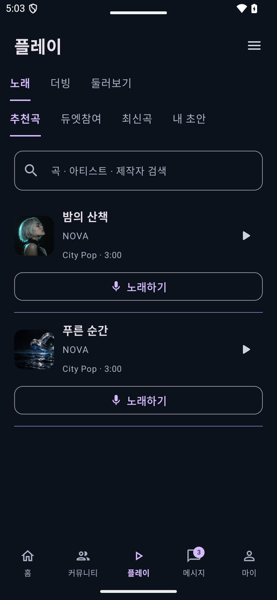
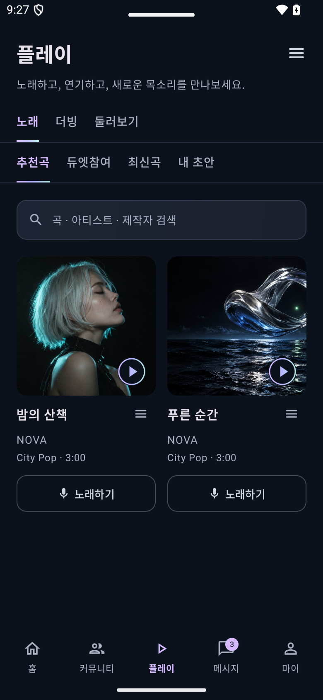

# AIFECT 2.5.56 — 모바일 웹 비교 후 화면 수정

2026-10-25 한국시간. 이전 2.5.55의 기능 검사 통과는 디자인 충실도를 입증하지 않는다. 이 작업은 사용자가 지적한 시각적 퇴보를 줄이기 위한 구체적인 수정 기록이며, 전체 화면 디자인에 대한 사용자 승인을 뜻하지 않는다.

## 비교 근거와 수정 범위

연결된 브라우저에서 운영 모바일 웹 `#karaoke`, `#profile`, `#community`, `#home`을 390×844 조건으로 직접 확인했다. 플레이의 앨범 카드, 마이의 프로필·버튼·갤러리·작품 구획, 커뮤니티의 탭·검색·방 카드 구성을 기존 앱 캡처와 비교했다. 비교 뒤 임시 브라우저 크기 설정을 해제했다.

| 영역 | 2.5.55에서 확인한 차이 | 2.5.56 수정 |
|---|---|---|
| 플레이 | 작은 앨범 이미지의 세로 목록과 분리된 큰 노래하기 버튼 | 운영 웹처럼 이미지 중심 2열 카드. 정사각형 표지, 표지 내 재생, 제목 오른쪽 메뉴, 창작자·장르·시간, 카드 하단 노래하기. 감상과 녹음 진입을 구분 |
| 검색·탭 | 기본 입력 외곽선, 양쪽 패딩이 누적된 탭, 진한 구분선 | 웹의 어두운 검색 표면·14px 상당 입력, 간결한 탭과 얇은 경계. 입력 즉시 필터링과 검색어 지우기 유지 |
| 마이 | 프로필 작업·팔로워를 큰 텍스트 버튼으로 분산. 작품 앞에 큰 보관함 타일이 나옴 | 프로필 옆 요약, 같은 높이 48dp의 프로필 수정·스튜디오 버튼, 갤러리 패널, 그라데이션 내 작품/내 활동 전환, 작품 카드. 보관함은 내 활동에서 유지 |
| 토킹룸 목록 | 공통 스크롤 탭과 큰 중앙 아이콘 위주의 카드 | 모바일 웹의 균등 3탭, 검색·생성 조작 높이 정리, 112dp 방 아트·실제 배경 테마·LIVE·인원·방 제목·방장 배치 |
| 홈 | 행 구분선의 불투명도를 45%로 덮어써 지나치게 진함 | 현행 웹 선 토큰의 16% 불투명도로 수정. 승인한 배너·추천·플레이리스트 배치는 유지 |

로고와 하단 메뉴 순서, 실제 API·인증·권한·녹음·더빙·WebRTC 엔진은 이번 수정에서 바꾸지 않았다. 운영 웹 소스와 DB는 수정하거나 배포하지 않았다.

## 실제 앱 비교 캡처

아래 이미지는 격리된 Android 테스트 앱의 실제 렌더링이다. 동일한 검증용 데이터로 비교했으며, 운영 회원이나 현재 서비스 콘텐츠를 나타내지 않는다.

| 수정 전 플레이 | 수정 후 플레이 |
|---|---|
|  |  |

- [수정 후 마이](review-256/my-after.png)
- [수정 후 토킹룸 목록](review-256/community-after.png)

## 검증과 설치

- `assembleDebug`, `assembleDebugAndroidTest`, `testDebugUnitTest`, `lintDebug` 통과. 단위 검사 69개, 실패·오류 0. Lint 오류 0, 경고 122.
- 최종 소스에서 플레이 분류·주요 버튼 표시, 마이 프로필·갤러리 유지·활동 전환, 토킹룸 기본 진입·검색·랭킹 기간 검사를 390dp와 320dp/글자 배율 1.3에서 실행했다. 각 3개, 총 6회 통과.
- 추가 캡처 비교에서 프로필 두 버튼의 높이 차이와 구분선 농도를 수정한 뒤 최종 빌드와 두 화면 조건의 검사를 다시 실행했다.
- 실제 패키지 `kr.co.aifect.app`, versionName `2.5.56`, versionCode `69`로 빌드했다. 테스트 패키지와 구분하고 기존 서명을 확인했다.
- 연결 휴대폰의 2.5.55에 `adb install -r` 업데이트: `Success`. 기기 설치 시각 `2026-10-25 18:30:28`. 설치 후 버전과 `MainActivity` 실행 `Status: ok`, 프로세스 실행을 확인했다. 앱 삭제·데이터 초기화는 하지 않았다.
- 설치 파일: `C:\Users\lseve\Desktop\AIFECT-2.5.56.apk`.
- SHA-256: `8F977D45EB209047D547DBE24DE0943933C1290DE4D590B4FED12F777305D0C6`.

이번 검증은 해당 화면 수정과 조작 확인에 한정한다. 실제 여러 명 동시 통화나 전체 기능에 대한 새 검증 완료로 확대해 보고하지 않는다.
