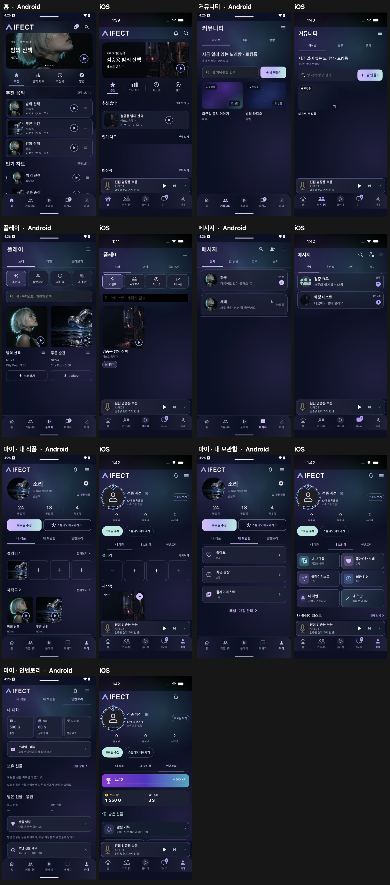
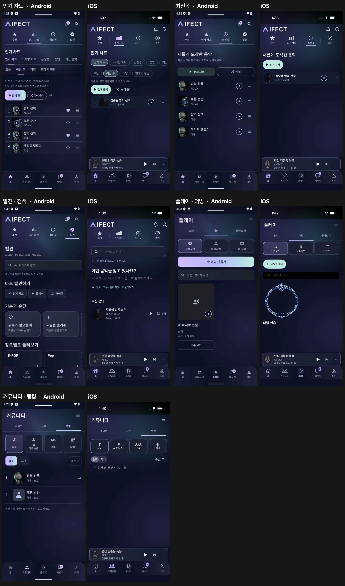
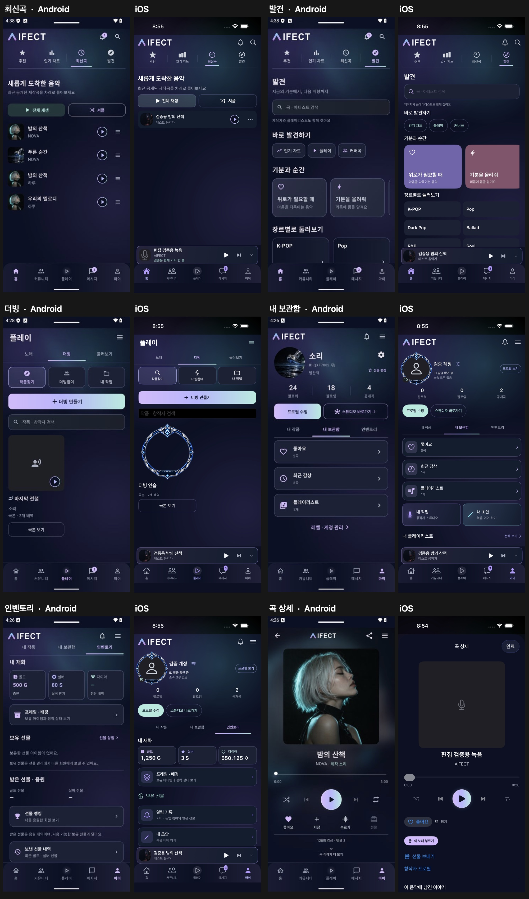
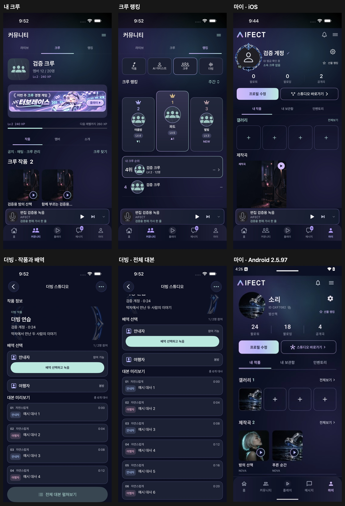

# AIFECT Android · iPhone 화면 대조

최신 대조 기준은 Android `origin/feat/android-release-143-ios-handoff-20261116`의 `74fbcf9`이며 Android 2.5.130 (143)이다. 2026-11-16 요청에 따라 이 브랜치를 iOS 작업 브랜치에 병합하고 `app/design/IOS-HANDOFF-20261116.md` 및 해당 Android 소스를 대조했다. 아래 과거 캡처는 각 날짜의 증빙이며 최신 Android 실행 화면을 새로 촬영한 것은 아니다.

같은 메뉴와 API를 연결한 것만으로 모든 오디오 동작·구매·인증 성공까지 동일하다고 판단하지 않는다. 일반 더빙의 제작·녹음은 이번 후속 작업에서 네이티브로 연결했다. 토킹룸·노래방 입장 후 화면은 여전히 웹 작업 화면이다. 실시간 합동 더빙은 2026-11-15 사용자의 명시적 요청으로 보류하며, 현재 완료 대상에서 제외한다.

전체 Android 동일화와 모든 UI의 최종 일대일 검사는 완료되지 않았다. 아래의 탭·메뉴 진입 검사, 개별 수정 화면 캡처, 더빙 시나리오 검증은 해당 범위의 증빙이며 모든 하위 화면·팝업·오류 상태의 일치를 뜻하지 않는다.

## 2026-11-17 Android 143 변경 반영

- 플레이: 노래의 추천·인기·듀엣 참여·내 초안, 더빙의 추천·인기·장르·신규. 더빙 만들기 위치, 공식 작품 포스터 선반, 주간/전체 인기, 장르 필터와 검색, 초보자 추천, 인원·재생시간, 실제 길이에 따른 소개 더보기/접기. 완성작은 둘러보기에서 소개·참여자 공개 ID를 확인하고 공용 플레이어로 이어 듣는다.
- 공통: 홈 인기 차트 페이지 애니메이션, 메시지 전체·공지·알림과 새 대화, 공지 세부·환영 안내, DM 길게 눌러 개별 삭제, 마이 우측 설정, 내 커버/듀엣/더빙 다중 선택 삭제와 부분 실패 보존, 크루 게임 테스트 배지 제거. 미니플레이어의 곡 정보/제어와 가사/좋아요·저장·재생 방식 배치를 맞췄다.
- 녹음: 마이크 입력 기본 100%, 범위 0~200%, PCM16 포화 처리. 배경/미리듣기 음량과 독립적이며 노래의 저장 보컬·청음에도 적용한다. 상대 파트 미리듣기는 선택한 가사 위치에서 실제 듀엣 안내 음원을 재생하며 녹음 시작 전에 멈춘다.
- 더빙 연속 녹음: 최초 카운트다운만 사용하고 배경 타임라인을 유지하며 이미 녹음한 내 대사를 건너뛴다. 대사별 WAV와 메타데이터를 확정한 뒤 기기 저장 완료를 표시한다. 서버 저장 진행 개수, 응답 유실 후 take ID 확인, 순차 리비전 업로드, 화면 종료 후 요청한 저장 유지, 다음 진입 시 미완료 업로드 재개를 연결했다. 저장 실패/중단 때 이전 파일을 유지한다.
- 속도: 정확한 요청 경로·계정별 제한된 메모리 캐시, 목록 먼저 표시 후 새 응답, 홈 부가 요청 최대 2개, 마이 상세 지연 조회. 권한·결제·잔액·녹음은 캐시 대상에서 제외하고 계정 변경/접근 거절 때 정리한다.
- 시뮬레이터 검사 중 소개 텍스트 높이 측정이 탐색 복귀 때 레이아웃 반복을 일으키는 문제를 발견해 폭 기준 계산으로 변경했다.
- 마지막 터치 검사에서 기본 TabView의 숨김 설정이 탭 하위에 전달되지 않아 하단 터치를 가로채는 현상을 재현했다. 각 탭 콘텐츠에서 기본 탭 바를 숨기고 다섯 탭 중앙을 직접 터치해 왕복하는 회귀 검사를 추가했다. 접근성 실행만으로는 발견되지 않던 문제다.

새 카드 편집기는 AI/직접/붙여넣기 3종 진입, 장면·대사 복제/이동/삭제/실행 취소, 별도 SFX/BGM, 원문 보존·미분류 검토, 기기 자동 저장/편집 위치 복원, revision 충돌 시 별도 복사, AI 수정안 비교를 지원한다. 서버의 기존 v1·총 24개 음향(BGM 최대 3개)·120대사·5분 제한을 유지한다. iPhone과 공통 API 범위이며 PC 웹/Android 편집 UI 전체 변경은 이 소스에 포함하지 않는다.

검증: `ios-1.0.7-shared-api.xcresult`의 단위 검사 100개 통과. 변경별 UI 11종은 `ios-143-verification2`, `ios-143-retest`, `ios-script-verification2`, `ios-script-final`, `ios-1.0.7-paste-final`, `ios-1.0.7-tab-fix` 묶음의 각 시나리오 최종 재검사에서 통과했다. 최종 공통 API를 사용하는 AI 비교와 다섯 탭 실제 터치 검사는 `ios-1.0.7-tab-fix`에서 함께 통과했다. 중간 실패는 숨겨진 실행 취소 버튼/접근성 이름, DM 팝업 닫기 테스트와 고립되지 않은 녹음 fixture를 수정한 뒤 재검사했다. 중간 `ios-1.0.7-shared-api`/`shared-api-retest`의 화면 검사는 하단 터치 문제로 실패했으며, 위의 각 탭 숨김 수정 후 통과했다. 전체 11종을 한 번에 실행한 결과라는 뜻은 아니다.

최종 운영 API는 웹 작업에서 게시한 Sites v791 `5398022`의 공통 `edit`/`suggestions`를 재사용한다. 이 API의 편집·생성 복구 서버 검사 11개 통과. 새 migration 및 실제 유료 AI 호출 없음. 앱은 구형 서버의 수정 기능을 읽기 전용 경로로 확인한 뒤 활성화한다.

직접 확인한 격리 시뮬레이터 캡처: [더빙 발견](parity/dubbing-discovery-20261117.png), [연속 녹음](parity/dubbing-continuous-20261117.png), [작은 화면 볼륨](parity/dubbing-volume-20261117.png), [붙여넣기 미리보기](parity/script-paste-preview-20261117.png), [AI 수정 비교](parity/script-ai-compare-20261117.png), [장면·음향 카드](parity/script-scene-sound-20261117.png), [하단 탭 터치](parity/bottom-tabs-touch-20261117.png). 운영 데이터는 공개 더빙 목록의 필드·포스터 주소 확인만 수행했다. 작품 삭제·녹음 제출·공지 읽음 등의 쓰기 시나리오는 외부 요청이 차단된 테스트 서버로 검사한다. 실기기 음질/지연·백그라운드 지속 시간·실제 로그인/결제/광고는 이번 시뮬레이터 검사의 범위가 아니다. 실시간 합동 더빙은 계속 보류한다.

## 2026-11-16 후속 동일화

Android 기준 브랜치를 다시 fetch했으며 기준 커밋은 여전히 `0634bae`다. 아래는 최신 Android 소스의 구성·크기·색상·액션을 대조하여 수정한 내용이다. Android 2.5.98 실행 화면을 새로 촬영한 것은 아니다. iOS는 iPhone 17 Pro / iOS 26.2 시뮬레이터에서 실행하고 XCTest 원본 캡처를 열어 확인했다. 실시간 합동 더빙은 계속 제외한다.

- 일반 더빙: 장르·참여 인원·길이·분위기·결말 선택창, 장면 추가와 대사 추가/삭제, 배역 취소·새 공연 시작·작품 삭제, 버전 더 보기, 작품 배경 이미지·배경 음향 플레이어·진행 파형, 내 배역/내 대사 배지, 댓글 입력, 녹음 카운트·진행률·완료 카드와 버튼을 반영했다. 편집 배역을 펼쳐진 선택 칩으로 표시하고 대본을 나갈 때 계속 작업/저장/저장 안 함을 선택한다. 녹음 중 뒤로 가기는 녹음을 정리한 뒤 저장 선택으로 이어진다. 진행 중인 AI 생성은 요청 ID를 보존하기 위해 저장하고 나가기만 제공한다. 삭제 시 대사 ID에 연결된 음향 큐도 정리하며 각 장면과 배역에 최소 한 줄을 유지한다. 편집 바인딩을 고정 ID로 바꾸어 앞 대사 삭제 후 다른 대사를 수정하지 않게 했다. 효과음 확인창은 서버가 보낸 chargeGold/priceGold를 사용한다.
- 홈/발견: 최신곡 2.15개 너비와 최근 감상 4개 너비, 표지 재생 버튼, 장르/기분 타일의 전체 배경, Android와 같은 장르 이미지 50개, 공개 플레이리스트·커버·AI 아티스트·창작자 선반, AI 아티스트 직접 팔로우와 숫자 갱신을 반영했다.
- 차트/플레이: 순위 행 48pt 표지·26pt 순위 영역·좋아요·더보기, 신인 2열 카드, 노래방 차트의 기간·장르·검색·가수 전환·직접 좋아요/프로필, 노래 카드의 제목·크레딧·길이·재생·곡 메뉴를 맞췄다. 노래방 차트는 Android와 같이 `include_unranked=1`을 보낸다. 인기 점수 대신 전일 순위 변동을 유지한다.
- 플레이리스트: 112pt 표지와 이름/소유자/곡 수, 표지 변경, 편집/삭제/전체 재생, 후보 곡 추가, 위로/아래로/빼기를 네이티브 화면에 반영했다. 후보 목록과 저장 목록의 행 ID를 구분해 추가한 곡에 이전 ‘추가’ 버튼이 남는 SwiftUI 재사용 문제를 수정했다.
- 크루 탐색: 추천 자동 전환 카드, 이름·관심사 검색, 모집/레벨/내 크루 필터, 정렬, 격자/목록 전환과 이미지·소개·인원·레벨 카드. 모집 필터는 정원이 찬 크루를 제외한다.
- 메시지: 아바타와 미리보기, 모두 읽음·내 DM 전체 삭제, 새 대화 검색, 프로필/팔로우/대화 메뉴, Android 스티커 카탈로그와 인라인 이미지 입력을 추가했다. 스티커 삽입 후 입력 위치·키보드를 이어 주며 백스페이스는 토큰 전체를 제거한다. WebP는 공용 이미지 디코더로 처리한다. 검색 결과에서 새 대화로 이동하는 경로도 수정했다.
- 스튜디오: 음원·AI 아티스트 전용 수정, 장르 최대 3개/분위기 최대 4개 선택, 아티스트·가사 방식 선택, 앨범 커버, MR 교체·재생성, 파일 업로드 진행률. 작업 화면에 하단 탭/미니플레이어가 겹치지 않도록 전체 화면으로 표시한다. 업로드 표지도 계정별 재시도 파일에 보관하여 응답 유실 후 원래 음원과 표지를 복구한다.
- 지갑/보상: 다이아 요약·골드 전환/정산 카드·금액 미리보기·정책과 이력 펼침, 오늘의 실버 요약·활동 카드·진행률과 활동 바로가기를 반영했다. 운영 계정의 결제/골드 지출/정산은 실행하지 않았다.

### 검증 기록

검증 결과는 관련 변경별로 실행한 `.xcresult` 묶음에 남긴다. 모든 UI 테스트를 한 번에 실행한 결과 또는 운영 서비스의 유료/인증 검증을 뜻하지 않는다. 테스트용 대본 캐시는 앱 실행마다 별도 경로를 사용하며 실제 계정의 초안은 건드리지 않는다.

- `ios-parity-final-20261116`: 단위 검사 81개 통과. 크루 필터/목록·전체 주요 탭·실제 AVAudioRecorder 연속 녹음 시나리오 통과.
- `ios-parity-input-retest-20261116`: DM/크루 긴 입력·녹음 편집, 홈 선반·아티스트 팔로우, 스튜디오 장르/분위기·AI 아티스트·MR, 더빙 대본/배역, 320pt 큰 글씨 녹음/볼륨 시나리오 통과.
- `ios-parity-chat-dubbing-retest-20261116`: 배역 취소→새 공연→대본 행 추가/삭제→장르/길이 선택 통과.
- `ios-parity-chart-playlist-chat-20261116`: 스티커 입력/삭제/전송→모두 읽음→새 대화 검색→내 DM 삭제, 플레이/차트→곡 상세 네 액션 통과. 처음 발견한 차트 접근성 조회와 플레이리스트 행 재사용 문제는 후속 검사에서 통과했다.

- `ios-parity-extended-20261116`: 차트 분류/노래방 가수, 더빙 관리/선택창, 플레이리스트 편집·곡 추가·이동·삭제, 주요 탭, 더빙 대본/배역 UI 5종 통과. 오디오 통합 검사의 고정 바이트 수 단언은 실제 입력 버퍼 시작 지연을 무시해 한 차례 실패했다. 0.5초 ±25ms 허용 범위와 파일의 실제 PCM 길이가 일치하는지, 대사 종료를 넘지 않는지 검사하도록 고친 뒤 재검사했다. 앱의 녹음을 늘이거나 무음으로 채운 것은 아니다.
- `ios-parity-verified-20261116`: 단위 검사 81개와 UI 4종 통과. 차트·노래방 순위, 더빙 배역·대본, 320pt 큰 글씨 볼륨/녹음 버튼, 전체 메뉴 17개 목적지 진입을 포함한다.

- `ios-parity-dubbing-exit-20261116`: 단위 검사 82개, 실제 연속 녹음·직접 대본 작성 통과. 저장 선택창의 계속 작업 버튼이 표시되지 않는 문제를 발견해 중앙 알림으로 수정했다.
- `ios-parity-dubbing-exit-fixed-20261116`: 더빙 관리/선택·계속 작업/삭제/저장 후 재진입, 실제 연속 녹음 세 파일 생성, 직접 대본 저장 후 목록 복귀 UI 3종 통과. 저장 또는 삭제를 마친 초안을 화면 종료 시 다시 만드는 문제도 막았다.

- `ios-parity-dubbing-artwork-20261116`: Android 기본 배역 아바타 도형 반영 후 작품 정보·전체 대본·배역 선택 재검사 통과.
- 이번 변경별 UI 시나리오 17종의 마지막 재검사가 모두 통과했다. 마지막 시뮬레이터 일반 실행에서 운영 홈 배너와 실제 곡 표지가 표시되는 것도 확인했다. 운영 더빙 제출·결제·골드 사용은 실행하지 않았다.
- 최종 arm64 Release(코드 서명 제외) 빌드 성공: `ios-parity-release-20261116.log`. 기존 카카오 SDK deprecated 경고와 App Intents 미사용 안내만 남았다. 빌드 번호는 변경하지 않았고 App Store 업로드·심사 제출은 하지 않았다.

### 직접 열어 확인한 iOS 화면

테스트 계정과 이미지로 촬영한 XCTest 원본이다. 최신 Android 실행 캡처와의 픽셀 일치를 입증하는 사진은 아니다. Android Kotlin의 구성·간격·카드 크기와 비교했다.

| 화면 | 원본 캡처 |
| --- | --- |
| 더빙 작품 정보·배역 | [작품 정보](parity/dubbing-project-20261116.png) |
| 전체 대본·배역 색상 | [대본](parity/dubbing-script-20261116.png) |
| 대본 제작·편집·저장 선택 | [선택 항목](parity/dubbing-options-20261116.png) · [배역·대사 편집](parity/dubbing-line-editor-20261116.png) · [나가기](parity/dubbing-save-leave-20261116.png) |
| 실제 연속 녹음 완료 | [세 대사 녹음](parity/dubbing-continuous-20261116.png) |
| 작은 화면·큰 글씨 녹음 | [녹음 조작](parity/dubbing-narrow-20261116.png) · [볼륨](parity/dubbing-volume-20261116.png) |
| 차트 | [신인 2열](parity/chart-newcomers-20261116.png) · [노래방](parity/karaoke-chart-20261116.png) |
| 홈·크루 | [홈 선반](parity/home-shelves-20261116.png) · [크루 카드](parity/crew-grid-20261116.png) |
| 대화·목록 관리 | [인라인 스티커](parity/chat-stickers-20261116.png) · [플레이리스트](parity/playlist-detail-20261116.png) |
| 스튜디오·정산 | [음원 수정](parity/studio-track-20261116.png) · [다이아](parity/diamond-wallet-20261116.png) |

## 2026-11-15 더빙 후속 작업과 Git 재확인

- 원격 전체 브랜치를 다시 fetch하고 더빙 소스를 검색했다. Android 기준은 여전히 `0634bae`이며, 마지막 더빙 변경은 `7bac809`의 실시간 더빙룸 1단계다. 사용자가 추가했다고 알려준 ‘파트별 녹음·연속 녹음’ 선택은 현재 원격 브랜치들에서 발견하지 못했다. 브랜치 또는 push 확인을 요청했다. 아래 연속 모드는 사용자의 설명에 따라 iOS에 먼저 구현한 것으로, 아직 새 Android 구현과 동등하다고 검증하지 않았다.
- `DubbingEditor.swift`: 13개 장르 중 최대 2개, 참여 인원 1~6명, 길이 30초~5분, 분위기·결말·세부사항, AI 생성 요청과 복구, 직접 작성, 배역·대사·연기 지시·시간 편집, 비공개 저장. 서버의 무료 잔여 횟수를 사용한다. 생성 요청 ID와 옵션을 계정별 보호 파일에 먼저 저장하고 응답 유실 시 같은 요청을 복구한다.
- `DubbingRecorder.swift`: 앱 내부의 배역별 녹음, 3초 카운트, 효과음 선행 구간, 전체 대본 펼침, 이전·다음 대사, 미리 듣기, 임시 저장, 권리 동의 후 전체 제출. 배역별 색상과 현재 대사 흰색, 하단 버튼 2열 구조를 반영했다.
- 파트별 모드는 한 대사씩, 연속 모드는 선택한 대사부터 내 배역을 순서대로 녹음한다. 배경 오디오는 이어 재생하고 각 내 대사만 별도 파일로 저장한다. 중단한 대사는 기존 녹음을 보존하고 완료한 대사만 교체한다. 이미 녹음한 대사를 연속으로 다시 녹음할 때 확인한다.
- 최신 원격 Android의 일반 더빙에는 볼륨 조절이 없었다. iOS 녹음 화면에 ‘볼륨’ 버튼을 추가해 배경 음향과 녹음한 목소리 재생을 각각 0~100%로 조절한다. 기존 음량을 유지하도록 기본은 100%다. 재생 중 AVAudioPlayer에 즉시 반영하고 모드 전환·다음 대사·다시 재생 후에도 해당 화면의 설정을 유지한다. 마이크 증폭이나 제출 파일의 믹싱 음량 설정이 아니며 화면에 이를 안내한다.
- 연속 녹음을 시뮬레이터에서 실제 AVAudioRecorder로 실행하면서 첫 대사가 0초일 때 카운트가 15ms 일찍 끝나 배경 재생을 시작하지 못하는 오류를 발견했다. 배경이 시작된 뒤에만 카운트를 끝내도록 수정했고, 0초·2초·4초의 세 대사 파일을 분리해 만드는 오디오 통합 검사가 통과했다. 녹음 원본을 바꾸지 않는 개별 재생 음량 검사도 추가했다.
- 서버가 받는 48kHz 모노 PCM16 WAV로 정규화하고 대사 종료 지점을 넘지 않게 자른다. 로컬 초안은 계정·작품·배경 버전·배역별로 격리한다. 저장 응답 유실 후 서버의 take ID를 확인해 이미 성공한 파일을 중복 업로드하지 않는다. 다른 기기가 교체한, 이미 업로드된 녹음은 덮어쓰지 않는다.
- 프로젝트의 배경 음향/완성 음원 듣기, 기본 배경/유료 효과음 확인, 모집 공개/중지, 음향 작업 상태 갱신, 댓글/좋아요도 네이티브로 연결했다. 유료 생성·공개·댓글·녹음 제출은 운영 계정으로 실행하지 않았다.
- 아직 차이: 대본 편집의 장면·대사 추가/삭제, 배역 취소·새 공연·작품 삭제와 신고 관리, 실제 인증/광고 시청을 통한 작성권 추가. 실시간 더빙룸의 공동 큐/배역 배정/RTC 통화는 사용자 요청으로 보류다. 보류 기능을 제외해도 전체 동기화 완료는 아니다.
- 볼륨 추가 전 검증: `ios-native-dubbing-complete.xcresult`에서 전체 단위 검사 75개와 UI 3개(`testDubbingScriptReaderAndRoleSelection`, `testNativeDubbingManualScriptCreation`, `testNativeDubbingModesScriptNavigationAndSubmission`)가 통과했다. 생성 요청 복구 검사에는 앱 재진입 후 동일 ID·원래 옵션 유지가 포함된다. 초반 UI 실패는 다중 행 입력의 XCTest 요소 종류를 잘못 찾은 테스트를 수정한 뒤 재검사했다. 최종 편집·연속 녹음 캡처를 직접 열어 입력창, 배역 색상, 버튼 너비를 확인했다.
- 후속 검증: `ios-native-dubbing-audio-fixed.xcresult`에서 전체 단위 검사 77개와 UI 3개가 통과했다. 연속 녹음의 세 대사 로컬 파일 생성, 재생 중 볼륨 변경, 모드·대사 전환 후 음량 유지, 제출 확인, 320pt/큰 글씨에서 녹음·저장·제출 버튼 접근을 검사했다. 이전 결과의 대본 작성·배역 선택 시나리오를 합하면 더빙 UI 5종이다. 최초 연속 녹음 실패 기록도 `ios-native-dubbing-volume.xcresult`에 보존하며 원인 수정 뒤 재검사가 통과했다.
- 직접 확인한 최종 시뮬레이터 화면: [볼륨 설정](parity/dubbing-volume-20261115.png), [연속 녹음 완료](parity/dubbing-continuous-20261115.png), [320pt·큰 글씨](parity/dubbing-narrow-20261115.png). Android 기준 소스의 56dp 표지·배역 색상·현재 대사·하단 두 열 버튼을 대조했다. 저장소의 예전 Android `polish-269` 캡처도 확인했으나 최신 Kotlin 배치를 우선했다. 테스트 장르 표지는 번들 스튜디오 이미지를 사용한다.
- 최종 arm64 Release 빌드(코드 서명 제외)가 성공했다. 로그는 `ios-native-dubbing-volume-release.log`이며, 기존 카카오 SDK의 deprecated 경고와 App Intents 미사용 안내만 남았다. App Store 업로드·심사 제출은 이 검증에 포함되지 않는다.
- 기기 없음은 사용자 확인 사항이다. 시뮬레이터 검사는 저장/복구·UI·파일 형식을 확인하며 실제 마이크/이어폰 지연·음질·두 기기 동시 녹음을 증명하지 않는다. 캡처의 그림과 음원은 격리된 테스트 자료다.

## 2026-11-15 최신 Git 반영

- iOS 방 테마 선택 검증 커밋 `7b11b6f`를 fast-forward로 반영했다. Android 소스와 기존 비교 사진을 직접 읽어 기본 화면의 배치 차이를 수정했다.
- 플레이·발견 검색은 48pt 어두운 테두리 입력창이다. 노래 카드의 장르·길이와 전체 너비 부르기 버튼, 발견 바로가기·기분 카드·장르 타일을 Android의 간격·색상·윤곽선에 맞췄다.
- 차트는 밑줄 탭과 표지 위 재생, 좋아요·더보기 동작을 사용한다. 점수 대신 서버의 전일 순위 변동을 유지한다. 곡 상세는 좋아요·저장·부르기·선물의 네 개 액션을 같은 너비로 배치했다.
- 마이 보관함은 좋아요·최근 감상·플레이리스트 세 줄과 계정 진입으로 정리했다. 플레이리스트에는 검색, 정사각형 2열 표지, 전체 재생, 관리, 공개 여부를 선택하는 생성 화면이 있다. 표지는 업로드 이미지 또는 실제 수록곡 표지를 사용한다.
- 인벤토리는 세 통화, 프레임·배경, 상점 진입, 사용 가능한 보유 선물, 받은 응원 합계, 보낸 선물 순서다. `/api/me/gift-inventory`의 실제 보유 단위를 표시하고 회원에게 보낼 수 있다. 응답 유실 후 같은 요청 ID로 재시도하며, 계정별 보호 파일에 미확인 요청을 보관한다.
- 스튜디오는 `/api/studio`의 업로드 한도·공개 음악·처리 중·AI 아티스트 수와 실제 음원 목록을 표시한다. 정보·가사·앨범 커버 수정, 기존 업로드 화면, 공개 상태 변경·삭제 경로를 연결했다. 저장 버튼은 키보드와 하단 플레이어에 가리지 않도록 상단에 둔다. 서버가 관리하는 장르·참여 정보는 기존 값으로 보존한다.
- 방 생성은 공개 범위·좌석 참여·배경 미리보기·인원·공지 순서로 표시한다. 서버에서 selectable로 제공한 배경만 노출하며 은퇴 테마를 제외한다. 없는 preferred_theme를 임의로 제출하지 않고 실제 선택 가능한 배경으로 정한다. 크루가 없는 계정은 크루 공개 방을 제출할 수 없다.
- 상점은 서버의 골드·실버 선물과 액자·토크룸 배경을 표시한다. 선물 수량 1~100개, 장식 사용 기간, 구매 후 잔액을 확인하고 인벤토리에 보관한다. 미확인 구매는 계정별 요청을 보존해 같은 내용으로 재시도한다. 인벤토리의 프레임을 3열로 정리하고, 보관 장식의 사용 시작·활성·만료 상태를 구분했다. 실제 골드 구매·장식 사용은 실행하지 않고 격리 응답으로 검사한다.
- 전체 메뉴 17개 목적지에 Android와 같은 아이콘·행 배치를 적용했다. 시스템 결제·로그인 화면은 iOS 방식을 유지한다.
- XCTest용 웹 작업 화면은 로컬 HTML만 표시하도록 분리했다. 검증 도중 운영 사이트에서 음성방·더빙·계정 작업이 실행되지 않는다.

### 검증 증빙

Xcode 26.6 / iPhone 17 Pro, iOS 26.2 시뮬레이터. Debug 및 arm64 Release(코드 서명 제외) 빌드가 성공했다. 단위 검사 69개, UI 시나리오 12종의 마지막 실행이 통과했다. 방 테마 선택·인원·공개 범위 제출, 상점 수량 구매·화면 재진입 후 같은 요청 재시도·기간 선택·보관 장식 활성화, 기존 다이아 전환·프레임 장착/해제 검사를 포함한다. 시나리오는 관련 변경별로 나누어 실행했으며 전체 UI 테스트 모음을 한 번에 실행했다는 뜻은 아니다. 플레이리스트 검색·생성·재생, 선물 응답 유실 후 중복 없이 재시도, 스튜디오 정보 수정·복귀 갱신, 곡 상세 네 액션, 발견·더빙·보관함 이동, 큰 글씨·빈 보관함 및 기존 좋아요 공유를 검사했다. 테스트 데이터의 선물·계정·음악은 운영 자료가 아니다.

최초 UI 검사에서 회원 행의 빈 부분 터치, 하위 버튼의 접근성 식별자, 키보드에 가려진 저장 버튼을 발견해 수정했다. 상점 재진입 후 상품 선택 시 빈 구매 시트가 열리는 오류도 재현해, 선택 상품으로 시트를 여는 방식으로 수정한 뒤 끝까지 통과했다. 재검사 결과 및 원본 캡처는 로컬 `work/ios-android-parity-20261115*.xcresult`와 `work/ios-android-parity-*-captures`에 보관한다. 두 실물 iPhone은 `devicectl`에서 unavailable이므로 실기기 설치·마이크·통화 검증은 수행하지 못했다. 이후 Mac 잠금으로 직접 UI 조작도 차단됐다. 잠금 전 시뮬레이터 검사와 XCTest가 남긴 원본 캡처를 직접 열어 배치를 확인했으며, Mac 및 iPhone 연결을 사용자에게 요청했다.

## 이전 비교 캡처 (오전 1시 43분)

왼쪽은 Android, 오른쪽은 iOS다. 시스템 상태 표시줄, 테스트 곡과 계정, 재생 중 여부는 서로 다르다. 마이 인벤토리 캡처는 스크롤 위치도 다르다.

### 이 캡처 당시의 차이

- 최신곡에서 Android는 전체 재생과 셔플을 나란히 표시한다. iOS는 전체 재생만 표시한다.
- 발견에서 Android는 검색 아래에 바로 발견하기·기분과 순간·장르 목록을 보여준다. iOS는 검색 안내와 추천 음악부터 보여준다.
- 플레이의 더빙 만들기는 Android에서 가로 전체 버튼, iOS에서 짧은 버튼이다. Android 작품 카드에는 극본 보기와 배역 정보가 추가된다.
- 마이의 내 보관함은 Android에서 좋아요·최근 감상·플레이리스트 세로 목록, iOS에서 격자와 추가 바로가기다. 인벤토리는 Android에서 세 통화 카드를 먼저, iOS에서 레벨 바와 지갑부터 보여준다.
- 자동화 데이터의 곡 개수, 방 테마, 앨범 사진, 크루와 랭킹 결과는 서로 다르다. 예컨대 iOS 테스트에서 더빙 카드에 보이는 액자 이미지는 테스트 이미지 응답이며 실제 서비스의 더빙 장르 이미지가 아니다.
- 시작 잔상은 마이 인벤토리 → 기기 홈 → 앱 종료 → 다시 실행 순서로 촬영했다. 25.9초 녹화에서 약 0.43초 간격으로 확인한 화면은 런치 로고 → 홈 → 앨범 표지 로딩 순서였다. 다시 실행한 뒤 이전 인벤토리는 보이지 않았다. 더 짧은 깜박임과 실물 기기 결과는 미확인이다.

## 인수 후 추가 대조

왼쪽은 Android 기준 캡처, 오른쪽은 수정 후 iPhone 17 Pro Max 검사 캡처다. 목록 수·이미지·재생 상태·스크롤 위치는 테스트 데이터에 따라 다르다. 곡 상세 iOS 캡처는 표지가 없는 테스트 녹음이다.

08:46 검사에서 곡 상세 → 창작자 프로필 이동 중 SwiftUI의 AppModel 전달이 누락돼 앱이 종료됐다. 상세 시트의 NavigationStack에 모델을 전달하고 재생창의 댓글 시트에도 탐색 스택을 연결했다. 08:56 최종 검사에서 단위 검사 64개와 UI 시나리오 4개가 통과했다. UI 검사는 곡 상세·재생창에서 프로필 이동, 다이아·인벤토리, 화면 대조 시나리오다. iPhone 17 Pro에 같은 바이너리를 설치해 운영 홈을 확인했다.

- 기준은 같은 Android 2.5.97 (110) 캡처다. 현재 연결된 Android 실물 기기는 없어서 설치본 2.5.98 (111)의 화면 일치는 검증하지 않았다.
- 최신곡은 전체 재생·셔플을 같은 너비로 배치했다. 발견의 초기 화면에 인기 차트·플레이·커버곡, 기분과 순간, 장르를 추가했다.
- 더빙 목록은 전체 너비 만들기 버튼, 작품별 상태·배역 수 및 다음 작업 표시를 적용했다. 일반 더빙 상세·녹음은 여전히 웹 작업 화면이다.
- 마이 보관함은 좋아요·최근 감상·플레이리스트를 위에서 아래로 표시하고 각각 해당 분류로 이동한다. 인벤토리는 골드·실버·다이아 세 카드를 맨 위에 놓고 아래에 프레임·배경 진입을 배치했다. 보유 선물 관리와 스튜디오 상세에는 차이가 남아 있다.
- 곡 상세는 큰 정사각형 표지, 중앙 제목, 탐색 슬라이더, 셔플·이전·재생/일시정지·다음·한 곡 반복을 표시한다. 전체 플레이어도 같은 재생 컨트롤을 사용한다. Android의 반복 모드는 전체 반복이어서 동작 차이가 있다.
- 전체 메뉴에서 AI 아티스트와 공개 플레이리스트가 비면 검은 화면만 보이던 경우를 확인했다. Android와 같은 목록 API를 사용하고 로딩·빈 결과·오류를 구분했다. AI 아티스트는 사진 2열 격자다.
- 더빙 탭을 누른 뒤 노래 화면에 남던 실패를 재현했다. 공용 탭의 전체 사각형이 터치를 받게 수정한 뒤 더빙 만들기 폭·극본 보기와 보관함에서 좋아요 분류로 이동하는 검사가 통과했다.
- 시작 잔상은 보존한 25.9초 동영상의 디코딩 가능한 366프레임을 확인했다. 재실행 로고가 보이는 9.06초 이후 218프레임을 이전 인벤토리 화면 표본과 비교했을 때 같은 화면이 다시 나타난 프레임을 찾지 못했다. 화면 녹화는 가변 프레임이어서 실기기의 짧은 잔상까지 배제할 수 없다.
- iOS 카카오톡 앱 경로는 SDK를 호출하고 설치되지 않았을 때 계정 웹 인증을 사용한다. Apple은 시스템 웹 인증, Google은 브라우저 경로다. 이 체크아웃의 iOS 앱 entitlement에는 Sign in with Apple 항목이 없고, 번들 GoogleService-Info.plist에는 iOS OAuth 클라이언트 ID가 없다. 사용자 계정으로 인증 완료 후 앱 복귀는 아직 검증하지 않았다.

## 크루 · 일반 더빙 · 마이 · 반복 재생

오른쪽 아래만 Android 기준 캡처이며, 나머지는 iPhone 17 Pro Max의 iOS 테스트 데이터다. 09:53 최종 검사에서 단위 테스트 69개와 크루·더빙 UI 시나리오 2개가 통과했다. 더빙 시나리오는 전체 6줄 펼치기, 6번째 대사 시작 시각, 배역 선택, 작업 화면 이동과 복귀 후 내 배역 표시를 확인한다. 첫 검사에서는 미니플레이어가 펼치기 버튼을 가렸다. 작업 화면을 전체 화면으로 바꾸고 목록 복귀 시 하단 바가 나타나는 것까지 재검사했다. 운영 계정으로 게임 점수를 올리거나 음성을 제출하는 절차는 검증하지 않았다. 같은 빌드를 iPhone 17 Pro 시뮬레이터에 설치해 운영 홈을 확인했다.

- 크루에 가입하면 커뮤니티에서 내 크루 홈을 연다. 미가입 이용자는 검색 목록으로 이동한다. 작품·멤버·소개 탭, 관리 화면, 디렉터리 왕복, 내 크루 순위 카드를 연결했다.
- 한국 시간 월요일 0시부터 토요일 0시까지 주간 게임 배너를 표시한다. 이번 주 서버 지정 게임을 우선하고, 지정값이 없거나 지난주 값이면 Android와 같은 SHA-256 계산을 쓴다. 서버가 현재 크루에 제공한 게임 주소만 연다.
- 크루 랭킹은 2·1·3위 순서로 배치한다. 순위 변동은 서버 기록을 사용한다. 테스트 데이터의 내 크루는 4위다.
- 일반 더빙 상세에서 작품 정보, 내 배역, 배역 선택, 시간순 대본과 전체 대본 펼치기를 SwiftUI로 제공한다. 제작·녹음·제출·음향은 기존 작업 화면으로 이동한다. 실시간 더빙룸은 제외했다.
- 마이의 프로필 수정·스튜디오 버튼, 계정 관리와 선물 랭킹, 통계 행을 변경했다. 곡 상세에서는 반복 끔과 전체 반복을 전환한다. 전체 재생창에서는 끔 → 전체 → 한 곡 순서다.

## 화면별 차이

| Android 화면 | iOS 구현 또는 이동 경로 | 대조 결과 |
| --- | --- | --- |
| 실행 · 복귀 | LaunchBackground, RootView | 시작 배경색과 백그라운드 스냅샷 처리 변경. 종료 후 홈 복귀 검사. 전환 중 모든 프레임은 미검증 |
| 홈 추천 배너 | ListenView, FeaturedMusicCarousel | 선택된 곡 표지, 어두운 왼쪽 오버레이, 배경의 앨범색, 4.5초 전환, 링 버튼 반영 |
| 홈 추천 목록 · 최신곡 · 최근 감상 | HomeTrackRow, StreamingArtworkShelf | 최신/최근 선반 너비·표지 재생·공개 플레이리스트/커버/아티스트/창작자 섹션 반영. 테스트 데이터로 시각 확인 |
| 인기 차트 · 기간 | PopularChartView | 기간·전일 변동·밀집 순위 행·신인 격자·노래방 차트 진입 반영 |
| 발견 · 장르 · 검색 | SearchView, ExploreView | 발견 바로가기·기분·장르 50개 이미지 반영. 검색 API와 디렉터리 연결 |
| 공개 플레이리스트 · AI 아티스트 | CatalogDirectory | 전체 메뉴와 홈 선반에 연결. 인기순 API·사진 2열 격자·직접 팔로우/인원 갱신 반영 |
| 플레이 · 노래 | MobilePlayView | 추천곡·듀엣참여·최신곡·내 초안, 검색, 2열 카드 반영. 정렬·캐시·카드 액션 차이 |
| 플레이 · 더빙 | MobilePlayView | 작품찾기·더빙참여·내 작업에서 네이티브 작품 정보·배역·극본으로 이동 |
| 플레이 · 둘러보기 | MobilePlayView | 추천·팔로잉·인기·최신과 작품 유형 필터, 더 보기 지원 |
| 일반 더빙 제작 · 배역 · 녹음 | NativeDubbingEditor, DubbingProjectPage, NativeDubbingRecorder | 제작·대본 편집·배역·파트별/연속 녹음·저장·제출을 네이티브로 연결. 새 Android 녹음 모드 원본과 실기기 음성 제출은 미검증 |
| 커뮤니티 · 라이브 로비 | LiveCommunity | 라이브·크루·랭킹 순서, 방 검색·방 종류·인원·테마 이미지 반영 |
| 토킹룸 · 노래방 생성과 입장 | LiveLobby, WorkspacePage | 생성 폼은 배경 미리보기와 함께 SwiftUI로 반영, 입장 후 웹. 운영 방 생성·통화·오디오 전환 미검증 |
| 크루 가입 · 탐색 · 홈 · 관리 | CrewsView, CrewPage, CrewEditor | 내 크루 홈·관리·디렉터리, 추천 카드·검색·모집/관심사/레벨 필터·정렬·격자/목록 반영 |
| 크루 주간 게임 · 미션 | CrewHome, WeeklyCrewBanner, WebWorkspacePage | 네 게임의 주간 선택·배너·앱 안에서 열기 반영. 운영 계정 플레이와 점수 반영 미검증 |
| 커뮤니티 랭킹 | CommunityRankings | 작품·AI 아티스트·크루·더빙 API 연결. 크루 시상대·내 크루 순위·이전 순위 변동 표시 반영 |
| 커버 랭킹 · 작품 정보 | CoverRankingView, TrackDetailView | 메뉴·댓글·좋아요·프로필 경로 있음. 곡 상세 중앙 표지·재생 컨트롤·하단 네 액션 반영. 가사·후원자 상세 펼침은 차이 |
| 메시지 목록 · 검색 · 공지 | MessagesView | 전체·안 읽음·크루·공지, 모두 읽음·내 DM 삭제·알림 기록 반영 |
| 개인 · 크루 대화 · 새 대화 | ChatPage, NewConversationView | 텍스트·사진·스티커·새 대화 검색·프로필/팔로우/알림/삭제. 입력·스티커·검색/복귀 검사 통과. 최신 Android DM 소스에는 음성 입력 없음 |
| 알림 기록 · 설정 | ActivityHistoryView, PushSettingsView | 공지 대화와 알림 기록 분리. 실기기 푸시 미검증 |
| 마이 프로필 · 팔로워 · 팔로잉 | MyMusicView, FollowingListView | 96pt 사진, 공개 ID 복사, 크루·계정·선물 랭킹 진입 및 통계·버튼 너비 반영 |
| 마이 · 내 작품 | MyMusicView | 갤러리·제작곡·커버/듀엣/더빙·소속 아티스트. 갤러리 선택은 프로필로 이동, 선반 배치 차이 |
| 마이 · 내 보관함 | MyMusicView, LibraryView | 좋아요·최근 감상·플레이리스트가 있음. 좋아요·최근 감상·플레이리스트를 세로 카드로 변경. 추가 바로가기 중복을 제거하고 계정 관리 진입만 유지 |
| 마이 · 인벤토리 | MyMusicView, PlayerInventoryView | 골드·실버·다이아 카드와 프레임·배경 진입을 상단에 표시. 보유 선물·전송·받은 합계·발신 기록 추가. 서버 상품 상점·기간 선택·보관 장식 사용 시작을 추가. 운영 계정 구매와 기간 만료 후 상태 전이는 미검증 |
| 다른 사람 프로필 · AI 프로필 · 갤러리 | ProfilePage, ListenerProfileView, ArtistGallerySection | 프로필과 사진 화면 존재. 인물 유형별 상세 동등성 미검증 |
| 재생 · 미니 플레이어 · 가사 · 대기열 | MiniPlayer, PlayerView, FullLyricsView, QueueView | 배너와 곡 행 재생 버튼 변경. 곡 상세와 전체 플레이어의 원형 재생 컨트롤 통일. 가사·대기열·반복 모드는 기존 iOS 구현 |
| 개인 보관함 · 플레이리스트 생성·수정 | LibraryView, PlaylistView, PlaylistPickerView | 표지 2열·검색·생성·재생, 상세 표지/이름/공개 편집·곡 추가/정렬/제거 반영 |
| 크리에이터 스튜디오 · 원곡 업로드 | CreatorWorkView, OriginalUploadView | 대시보드·음원/AI 아티스트 전용 편집·표지·장르/분위기/가사 선택·MR 교체/재생성 반영 |
| 솔로 · 듀엣 녹음 · 편집 · 게시 · 초안 | StudioView, DuetPartEditor, RecordingDraftsView | iOS 녹음기가 따로 있음. 녹음 효과, 편집 타임라인, 실제 게시 전 과정 미검증 |
| 선물함 · 보내기 · 선물 랭킹 | GiftWalletView, GiftSheetButton, ProfileGiftRankingView | 카탈로그 이미지·보유 선물 전송·받은 합계·발신 기록 반영. 선물 상점·수량 구매·재시도 추가. 실제 운영 상품의 구매는 미실행 |
| 장식 상점 · 프레임 · 방 테마 | ItemShopView, PlayerInventoryView, DecorationUseView | Android처럼 선물 3열·장식 2열, 기간 선택, 보관·사용 시작을 네이티브로 구현. 실거래는 실행하지 않음 |
| 골드 · 프리미엄 · 오늘의 실버 | PaymentStoreView, RewardsView | StoreKit 기반 결제, 실버 요약·활동 카드·진행률·활동하기 반영. 실제 구매·보상 신청 미검증 |
| 다이아 · 정산 · 수익 | DiamondWalletView, CreatorEarningsView | 다이아 요약 카드·금액 미리보기·전환/정산·정책/이력 펼침 반영. 별도 수익 명세 페이지는 iOS 목록을 유지 |
| 전체 메뉴 | AppMenuView | Android 원본 17개 항목·순서·아이콘과 행 간격 반영 |
| 이메일 · 간편 로그인 | LoginView, AppModel | 이메일은 앱 내부. 카카오 SDK는 설치된 카카오톡 우선. Google은 브라우저, Apple은 제공자 시스템 웹 인증. 실제 계정 교환 미검증 |
| 계정 · 차단 · 삭제 · 신고 | AccountSettingsView, BlockedUsersView, DeleteAccountView, TrackCommentsView | 계정 관리와 신고 관련 화면은 별도 구현. 파괴적 작업 미실행 |
| 마이크 · 카메라 · 배경 오디오 · OS 결제/인증 시트 | 각 플랫폼 시스템 UI | 시뮬레이터 비교만으로 실기기 권한·주변기기·계정 상태별 일치 판정 불가 |

## 검증 범위

- Android 2.5.97의 격리된 테스트 설치본에서 하단 5개 탭, 마이의 세 영역, 곡 상세를 여는 기준 검사가 통과했다. 추가 UI 시나리오 18개 중 9개가 통과했다. 나머지 9개에서 이전 메뉴 이름·테스트 태그를 찾지 못하거나 구성 요소 표시 검사에 실패했다. 실패한 시나리오의 뒷부분은 실행 검증 범위에 포함하지 않았다.
- iPhone 17 Pro 시뮬레이터에서 홈 4개, 커뮤니티 3개, 플레이 3개, 메시지 4개, 마이 3개 탭 및 재실행 홈을 캡처했다. iOS 단위 검사 64개와 비교 화면 이동, 비로그인·오류 상태 검사가 통과했다.
- 전체 메뉴 17개를 차례로 열고 캡처했다. 첫 검사에서는 마지막 정산 항목을 누를 때 하단 바가 터치를 받았다. 첫 수정 뒤에도 02:06 캡처의 마지막 화면은 전체 메뉴였다. 당시 검사는 목적지 제목을 확인하지 않아 이를 통과로 집계했다. 마지막 항목 아래에 스크롤 여백을 넣고 정산 제목을 검사한 뒤 08:50에 17개 메뉴 순회가 통과했다. 마지막 캡처에서 정산 제목과 잔액을 확인했다.
- iOS 로그인에서 Kakao·Apple·Google 버튼 3개가 각각 노출되는 것을 확인했다. 테스트 계정으로 공급자 인증을 완료하거나 실물 카카오톡 앱과 왕복하는 검사는 하지 않았다.

## 소스 인벤토리

아래는 최초 대조 당시 버전 관리되는 운영 소스의 Android Compose 선언, Android Activity, iOS SwiftUI 뷰를 파일별로 추출한 목록이다. 작은 버튼과 공용 구성 요소도 포함한다. 선언 수는 화면 수가 아니다. 테스트 캡처와 소스 검토를 구분하기 위한 검색 색인이다.

### Android

- kr/co/aifect/app/AIArtistDirectoryGrid.kt — AIArtistDirectoryGrid, AIArtistSquareTile
- kr/co/aifect/app/ActivityScreens.kt — NotificationEntry, ActivitySheet, GiftHistorySheet, SentGiftHistoryPage
- kr/co/aifect/app/AppPages.kt — appPageIsOpen, AppPageScope, AppPageHost, AppPage, AppMenuPage, PageMenuItem, AppFormPage
- kr/co/aifect/app/ArtistPhotoGallery.kt — ArtistPhotoGallery
- kr/co/aifect/app/AutoCarousel.kt — rememberAutoCarousel
- kr/co/aifect/app/BrandComponents.kt — BrandButton, BrandPlayButton, TrackActionsMenu
- kr/co/aifect/app/BrowseScreens.kt — ListenScreen, ListenTabs, TwoLineSongRow, HomeRecommendedRow, HomePlaybackButton, HomeChartRow, HomeReleaseShelf, HomeDiscoveryTiles, WelcomeMusic, FeaturedCarousel, StreamingRecentShelf, SingInvitation, MoodShelf, MoodTile, SongShelf, CompactShelf, CompactMusicRow, HomeArtistShelf, PersonCard, PlaylistArt, PlaylistShelf, PlaylistRow, GenreGrid, DiscoveryChip, SearchScreen, SingScreen, PlayButtons, CollectionSheet, LibraryScreen, LibraryPage
- kr/co/aifect/app/ChartScreen.kt — ChartScreen, ChartTabs, ChartSongRow, NewcomerCard
- kr/co/aifect/app/ChatFeatures.kt — ChatImage, DmActions, DmAttachments, CrewHomeBanner, CrewMuteAction, ProfileGiftRanking
- kr/co/aifect/app/CommentReportDialog.kt — CommentReportDialog
- kr/co/aifect/app/CommunityDiscovery.kt — CommunityPhoto, CommunityChoice, CurrentCrewDirectory, CrewState, FeaturedCrewCard, CrewPhotoCard, CurrentRankings, CommunityRankRow
- kr/co/aifect/app/CommunityFeedCard.kt — CommunityCard
- kr/co/aifect/app/CoverRankingScreens.kt — CoverRankShowcase, CoverRankingSheet, KaraokeChartRow
- kr/co/aifect/app/CreatorStudioScreen.kt — CreatorStudioScreen, StudioPanel, StudioImage, StudioTrackEditor, StudioTrackForm, StudioConsent, StudioField, StudioArtistEditor, StudioBackingControls, StudioChoiceField
- kr/co/aifect/app/CrewGameHub.kt — CrewGameButtons, rememberCrewKstDate, NativeCrewHome
- kr/co/aifect/app/CrewRankingDesign.kt — DefaultCrewArtwork, RankCrewPhoto, RankCrown, CrewRankPodium, MyCrewRank
- kr/co/aifect/app/CurrentExperience.kt — currentRead, ReadStatus, CurrentTabs, CurrentHeader, CurrentPlayScreen, RecordingDraftsContent, SignInEntry, CurrentEmpty, CurrentSongRow, CurrentPlayDubbingCard, CurrentCommunityScreen, CurrentRoomEmpty, CurrentMyScreen, CurrentActivityLinks
- kr/co/aifect/app/CurrentVisuals.kt — CurrentSearch, CurrentSongCard, CurrentSongGrid, CurrentDubbingCard, CurrentPanel, CurrentMySwitch, CurrentRoomCard
- kr/co/aifect/app/CurrentWorkspace.kt — CurrentWorkspacePage
- kr/co/aifect/app/DecorationShopScreen.kt — DecorationShopPanel
- kr/co/aifect/app/DiamondScreen.kt — DiamondSheet, DiamondPanel, DiamondModeButton, DiamondValueRow, DiamondPolicyRow, DiamondHistoryHeader
- kr/co/aifect/app/GiftScreens.kt — GiftEntry, GiftSheet
- kr/co/aifect/app/InventoryDecorationConfirm.kt — InventoryDecorationConfirm
- kr/co/aifect/app/ItemShopScreen.kt — GiftItemImage, ItemShopPage
- kr/co/aifect/app/MainActivity.kt — MainActivity
- kr/co/aifect/app/MessageInbox.kt — MessageInbox, MessageInboxRow, UnreadCount, NewConversationPage
- kr/co/aifect/app/MobileExperienceActivity.kt — MobileExperienceActivity
- kr/co/aifect/app/MusicCommunityScreens.kt — SaveMusicButton, MusicCommunityScreen, MusicProfileHeader, ProfileBiography, ProfileStatistic, MyMusicScreen, CommunityCrewPreview
- kr/co/aifect/app/MusicGalleryComponents.kt — musicGalleryColumns, MusicLayoutControl, MusicGalleryCard, MusicGalleryRow, MusicGallerySave
- kr/co/aifect/app/MusicSurfaces.kt — AlbumListeningBackdrop
- kr/co/aifect/app/MyInventoryContent.kt — MyInventoryContent, InventoryBalanceCard, ReceivedGiftTotal, InventoryEntry, MyGiftRankingPage
- kr/co/aifect/app/NativeDubbingScreen.kt — NativeDubbingScreen, NativeDubbingLibrary, NativeDubbingCreate, DubbingScriptEditor, NativeDubbingProject, NativeDubbingRecorder, DubbingLeaveDialog, NativeDubbingComments, DubbingSectionTitle, DubbingChip, DubbingRoleChip, DubbingExpandButton, DubbingLineCard, DubbingInfoCard, DubbingWave, DubbingVersions, DubbingProgressHeader, DubbingProgressCard
- kr/co/aifect/app/NativePerformanceActivity.kt — NativePerformanceActivity
- kr/co/aifect/app/NativeScreens.kt — BrandLockup, AifectApp, Heading, Section, Artwork, neutralChipColors, Chips, Empty, SongRow, Avatar, CommunityScreen, MiniPlayer, PlayerSheet, LoginSheet, AccountSheet, AccountSettingsSheet, AccountMenuRow, SongSheet, PlaylistEditor, PlaylistSheet, ProfileSheet
- kr/co/aifect/app/NativeVoiceScreen.kt — NativeAudioHeader, NativeVoiceScreen, NativeMemberAvatar, NativeVoiceSoundSettings, NativeRoomMusic, NativeRoomInvite, NativeRoomGift
- kr/co/aifect/app/NavigationScreens.kt — NavigationSheet, entry, MusicDirectoryScreen
- kr/co/aifect/app/OfficialAiBadge.kt — OfficialAiBadge
- kr/co/aifect/app/OwnedGiftSendScreen.kt — OwnedGiftSendPage
- kr/co/aifect/app/PlayBillingScreen.kt — PlayBillingSheet
- kr/co/aifect/app/PlayDesign.kt — DefaultProfileArtwork, PlaySections, SelectionField, SelectionSheet, DuetParticipationRow, DubbingCover
- kr/co/aifect/app/PlayerExperienceScreen.kt — PlayerExperiencePage, XPDetailRow
- kr/co/aifect/app/PlayerProgress.kt — PlayerAvatarDecoration, PlayerXPCard, PlayerHomePanel, PlayerInventorySheet, PlayerLevelStrip
- kr/co/aifect/app/PlayerQueueSheet.kt — PlayerQueueSheet
- kr/co/aifect/app/ProfileCrewInvite.kt — ProfileCrewInvite
- kr/co/aifect/app/ProfilePhotoViewer.kt — ProfileImage, ProfilePhotoViewer, ProfileGalleryDialog, PublicProfileGallery
- kr/co/aifect/app/ProfileScreens.kt — ProfileEditorSheet, RewardsSheet
- kr/co/aifect/app/RecipientOwnedGifts.kt — RecipientOwnedGifts
- kr/co/aifect/app/RecordingDraftsScreen.kt — RecordingDraftsSheet, RecordingDraftPreview
- kr/co/aifect/app/RedesignComponents.kt — WebMusicBanner, HomeSingingDiscovery, SingReadyCards, SingReadyCard, GenreTags, MusicBannerPanel, CrewAboutPanel, CrewDiscoveryCard
- kr/co/aifect/app/ReferenceDesign.kt — ReferenceLibrary, ReferencePlaylistGridPage, ReferencePlaylistTile, ReferenceActivity
- kr/co/aifect/app/ReferenceListening.kt — ReferenceSongHero, ReferenceSongDescription, ReferenceLyrics, ReferenceSupporters
- kr/co/aifect/app/ReferenceWorks.kt — ReferenceWorkCard, ReferenceWorkShelf, ReferenceWorksPage
- kr/co/aifect/app/RoomReferenceUi.kt — RoomTitle, roomStickers, RoomStickerPicker, stickerPreview, StickerText, RoomMessageBody, StickerTextField, RoomChatBubble
- kr/co/aifect/app/SafetyScreens.kt — SongShareButton, UserSafety, TrackSafety, SafetySettings
- kr/co/aifect/app/SocialScreens.kt — CrewScreen, CrewEditor, MessagesSheet, MessageProfileAvatar, ChatComposer, ChatHistory, CrewMemberDialog
- kr/co/aifect/app/SongCommentCount.kt — verifiedSongCommentCount
- kr/co/aifect/app/StreamingComponents.kt — StreamingSection, StreamingIcon, MusicLibraryShortcuts, StreamingSongRow, MusicEntry, MyWorkShortcut, StreamingPlaylistRow
- kr/co/aifect/app/VoiceRoomForm.kt — VoiceRoomBackdrop, RoomCreateBackdrop, NativeRoomForm, RoomFormLabel, roomFieldColors, RoomCapacityStepper, RoomSegment, RoomSettingRow, RoomThemeTile, RoomChoiceRow, RoomChoiceDialog
- kr/co/aifect/app/VoiceRoomWidgets.kt — VoiceGiftArt, VoiceGiftMessage, VoiceGiftAnimation, VoiceMusicBar, VoiceSeatAlert, VoicePlaylistPicker, VoiceProfilePopup
- kr/co/aifect/app/WebParityComponents.kt — MyWalletPanel, WalletHistoryPage, PlaylistCoverImage, PlaylistImageEditor, AlbumImageEditor, SongCoverTabs
- kr/co/aifect/app/karaoke/KaraokeActivity.java — KaraokeActivity
- kr/co/aifect/app/karaoke/VocalActivity.java — VocalActivity

### iOS

- AIFECTApp.swift — AifectWordmark, AifectAppMark, CoverArt, RootView, SongRow, RetryCard, SearchView, CommunityView, SongActions, MiniPlayer, PlayerView, MusicShelf
- AccountViews.swift — LoginView, AccountView, LibraryView, PlaylistView, AccountSettingsView, TrackDetailView, DeleteAccountView, BlockedUsersView
- ActivityHistoryView.swift — ActivityHistoryView
- ArtistGallery.swift — ArtistGallerySection
- ChatFeatures.swift — PrivateChatPhoto, ChatPage, ChatRoomView
- CreatorEarningsView.swift — CreatorEarningsView
- DiamondWallet.swift — DiamondWalletView, PayoutAccountEditor
- DiscoveryViews.swift — MusicCollectionView, ExploreView, CoverRankingView, QueueView, FullLyricsView, CatalogDirectory
- GiftViews.swift — MyWalletSummary, GiftSheetButton, GiftWalletView, RewardsView, ProfileGiftRankingView, TrackGiftRankingView
- ListenDesign.swift — ListenView, HomeTrackRow, FeaturedMusicCarousel, StreamingArtworkShelf, MoodMusicShelf
- LiveCommunity.swift — LiveCommunity, LiveLobby, RoomCreation, CommunityRankings, RankingSongDetail
- MusicSurface.swift — MusicSurface, PartnerBadge, CatalogBackdrop
- OriginalUploadView.swift — OriginalUploadView
- ParityComponents.swift — PageHeading, MusicSectionHeading, ParityChips, AlbumArtwork, SaveMusicButton, PlaylistPickerView, SingSongButton, MusicGrid, CommunityMusicCard, CommunityPlayControl, MainBottomBar, StreamingRootHeader, CoverRankHighlights, ResponsiveProfilePhoto
- PlatformControls.swift — CatalogHeader, CatalogTabs, ArtworkPlayButton, WorkspacePage, WorkspaceBrowser
- PushNotifications.swift — PushSettingsView, PushDestinationView
- RedesignComponents.swift — MusicBannerPanel, CompactMusicRow, CrewMembershipGraphic, WebMusicBanner, StudioAtmosphere, MusicIllustration, SingReadyCard, GenreTags, CreatorPreviewCard, SingReadyGrid, CommunityCrewRanking
- RemoteArtwork.swift — RemoteArtwork
- SocialViews.swift — PersonRow, ProfilePage, ProfileEditorView, MessagesView, NewConversationView, CrewsView, CrewEditor, CrewPage, LoginPrompt, ProfilePhoto, MyMusicView, FollowingListView, ListenerProfileView, CrewArtwork, CrewBanner, CrewDirectoryCard, CrewRecruitingBadge, CrewStatistic, CrewLevelBadge, CrewLevelProgress, CrewGrowthGuide, CrewEmptyCard, PlayerLevelCard, PlayerInventoryView
- StorePayments.swift — PaymentStoreView
- StreamingUX.swift — StreamingTabs, StreamingHeading, MusicLibraryShortcuts, StreamingSongRow, StreamingPlaylistRow, StreamingEntry, SongMenuView, OriginalSongPage, AppMenuView, CreatorWorkView, PopularChartView, StreamingActionTile, StreamingSegment, StreamingLevelStrip
- StudioControls.swift — StudioVocalControls, StudioVolumeBalance, StudioLyricWheel, DuetColorLegend
- StudioViews.swift — SingView, SingCatalogView, DuetInvitationsView, DuetJoinButton, StudioView, DuetPartEditor, RecordingWaveform, RecordingPositionPicker, RecordingDraftsView, MobilePlayView
- TrackCommentsView.swift — TrackCommentsView
