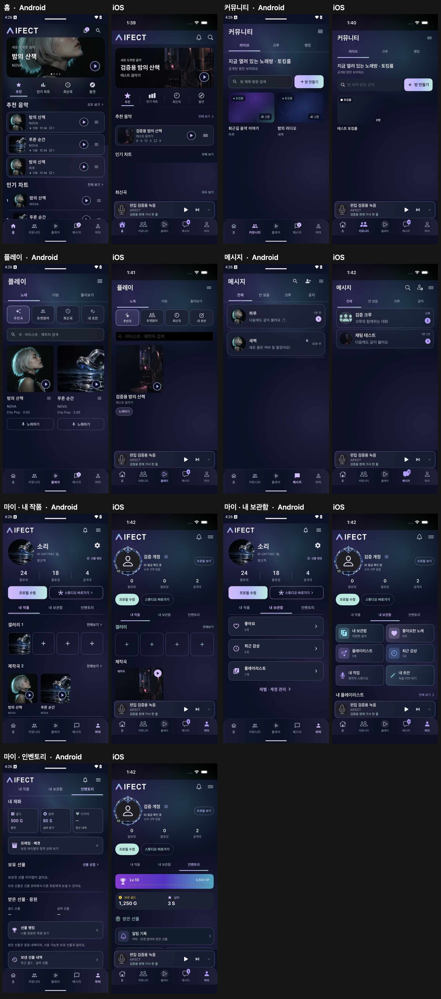
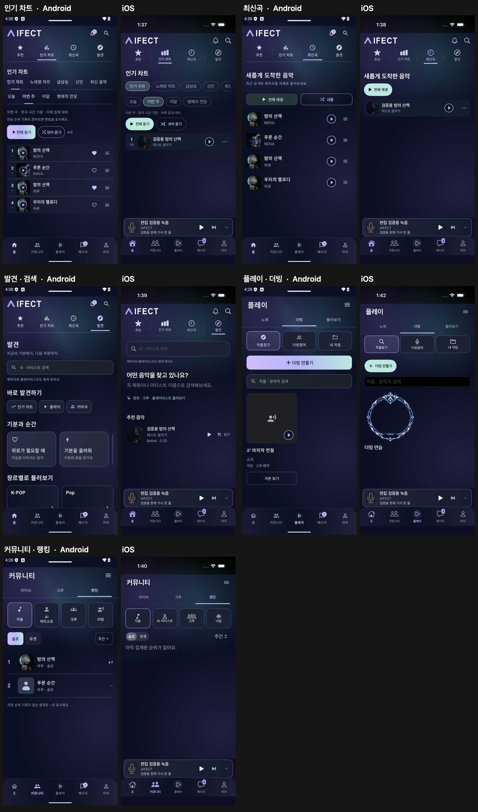
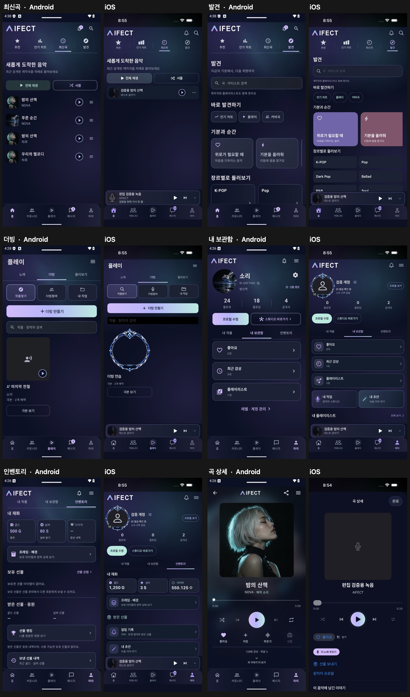

# AIFECT Android · iPhone 화면 대조

기준은 Android 2.5.97 (110), iPhone 17 Pro 시뮬레이터의 iOS 앱 1.0.5 (15)다. 실시간 더빙룸은 범위에서 제외했다. 사진과 곡 목록은 각 플랫폼의 테스트 계정 데이터다. 같은 이름의 메뉴가 존재해도 상세 화면, 오디오 동작, 구매·인증 성공까지 같다는 뜻은 아니다.

## 이전 비교 캡처 (오전 1시 43분)

왼쪽은 Android, 오른쪽은 iOS다. 시스템 상태 표시줄, 테스트 곡과 계정, 재생 중 여부는 서로 다르다. 마이 인벤토리 캡처는 스크롤 위치도 다르다.

### 이 캡처 당시의 차이

- 최신곡에서 Android는 전체 재생과 셔플을 나란히 표시한다. iOS는 전체 재생만 표시한다.
- 발견에서 Android는 검색 아래에 바로 발견하기·기분과 순간·장르 목록을 보여준다. iOS는 검색 안내와 추천 음악부터 보여준다.
- 플레이의 더빙 만들기는 Android에서 가로 전체 버튼, iOS에서 짧은 버튼이다. Android 작품 카드에는 극본 보기와 배역 정보가 추가된다.
- 마이의 내 보관함은 Android에서 좋아요·최근 감상·플레이리스트 세로 목록, iOS에서 격자와 추가 바로가기다. 인벤토리는 Android에서 세 통화 카드를 먼저, iOS에서 레벨 바와 지갑부터 보여준다.
- 자동화 데이터의 곡 개수, 방 테마, 앨범 사진, 크루와 랭킹 결과는 서로 다르다. 예컨대 iOS 테스트에서 더빙 카드에 보이는 액자 이미지는 테스트 이미지 응답이며 실제 서비스의 더빙 장르 이미지가 아니다.
- 시작 잔상은 마이 인벤토리 → 기기 홈 → 앱 종료 → 다시 실행 순서로 촬영했다. 25.9초 녹화에서 약 0.43초 간격으로 확인한 화면은 런치 로고 → 홈 → 앨범 표지 로딩 순서였다. 다시 실행한 뒤 이전 인벤토리는 보이지 않았다. 더 짧은 깜박임과 실물 기기 결과는 미확인이다.

## 인수 후 추가 대조

왼쪽은 Android 기준 캡처, 오른쪽은 수정 후 iPhone 17 Pro Max 검사 캡처다. 목록 수·이미지·재생 상태·스크롤 위치는 테스트 데이터에 따라 다르다. 곡 상세 iOS 캡처는 표지가 없는 테스트 녹음이다.

08:46 검사에서 곡 상세 → 창작자 프로필 이동 중 SwiftUI의 AppModel 전달이 누락돼 앱이 종료됐다. 상세 시트의 NavigationStack에 모델을 전달하고 재생창의 댓글 시트에도 탐색 스택을 연결했다. 08:56 최종 검사에서 단위 검사 64개와 UI 시나리오 4개가 통과했다. UI 검사는 곡 상세·재생창에서 프로필 이동, 다이아·인벤토리, 화면 대조 시나리오다. iPhone 17 Pro에 같은 바이너리를 설치해 운영 홈을 확인했다.

- 기준은 같은 Android 2.5.97 (110) 캡처다. 현재 연결된 Android 실물 기기는 없어서 설치본 2.5.98 (111)의 화면 일치는 검증하지 않았다.
- 최신곡은 전체 재생·셔플을 같은 너비로 배치했다. 발견의 초기 화면에 인기 차트·플레이·커버곡, 기분과 순간, 장르를 추가했다.
- 더빙 목록은 전체 너비 만들기 버튼, 작품별 상태·배역 수 및 다음 작업 표시를 적용했다. 일반 더빙 상세·녹음은 여전히 웹 작업 화면이다.
- 마이 보관함은 좋아요·최근 감상·플레이리스트를 위에서 아래로 표시하고 각각 해당 분류로 이동한다. 인벤토리는 골드·실버·다이아 세 카드를 맨 위에 놓고 아래에 프레임·배경 진입을 배치했다. 보유 선물 관리와 스튜디오 상세에는 차이가 남아 있다.
- 곡 상세는 큰 정사각형 표지, 중앙 제목, 탐색 슬라이더, 셔플·이전·재생/일시정지·다음·한 곡 반복을 표시한다. 전체 플레이어도 같은 재생 컨트롤을 사용한다. Android의 반복 모드는 전체 반복이어서 동작 차이가 있다.
- 전체 메뉴에서 AI 아티스트와 공개 플레이리스트가 비면 검은 화면만 보이던 경우를 확인했다. Android와 같은 목록 API를 사용하고 로딩·빈 결과·오류를 구분했다. AI 아티스트는 사진 2열 격자다.
- 더빙 탭을 누른 뒤 노래 화면에 남던 실패를 재현했다. 공용 탭의 전체 사각형이 터치를 받게 수정한 뒤 더빙 만들기 폭·극본 보기와 보관함에서 좋아요 분류로 이동하는 검사가 통과했다.
- 시작 잔상은 보존한 25.9초 동영상의 디코딩 가능한 366프레임을 확인했다. 재실행 로고가 보이는 9.06초 이후 218프레임을 이전 인벤토리 화면 표본과 비교했을 때 같은 화면이 다시 나타난 프레임을 찾지 못했다. 화면 녹화는 가변 프레임이어서 실기기의 짧은 잔상까지 배제할 수 없다.
- iOS 카카오톡 앱 경로는 SDK를 호출하고 설치되지 않았을 때 계정 웹 인증을 사용한다. Apple은 시스템 웹 인증, Google은 브라우저 경로다. 이 체크아웃의 iOS 앱 entitlement에는 Sign in with Apple 항목이 없고, 번들 GoogleService-Info.plist에는 iOS OAuth 클라이언트 ID가 없다. 사용자 계정으로 인증 완료 후 앱 복귀는 아직 검증하지 않았다.

## 화면별 차이

| Android 화면 | iOS 구현 또는 이동 경로 | 대조 결과 |
| --- | --- | --- |
| 실행 · 복귀 | LaunchBackground, RootView | 시작 배경색과 백그라운드 스냅샷 처리 변경. 종료 후 홈 복귀 검사. 전환 중 모든 프레임은 미검증 |
| 홈 추천 배너 | ListenView, FeaturedMusicCarousel | 선택된 곡 표지, 어두운 왼쪽 오버레이, 배경의 앨범색, 4.5초 전환, 링 버튼 반영 |
| 홈 추천 목록 · 최신곡 · 최근 감상 | HomeTrackRow, StreamingArtworkShelf | 목록과 섹션 순서 수정. 선반 너비, 행 간격, 커버 및 통계의 배치는 여전히 차이 |
| 인기 차트 · 기간 | PopularChartView | 차트 기간과 곡 상세 진입 존재. 순위 카드의 시각 일치 미확인 |
| 발견 · 장르 · 검색 | SearchView, ExploreView | 검색과 디렉터리가 있음. 발견 첫 화면에 바로가기·기분·장르를 표시. 검색 결과와 장르 타일 이미지는 차이 |
| 공개 플레이리스트 · AI 아티스트 | CatalogDirectory | 전체 메뉴에 각각 연결. iOS도 인기순 프로필 API와 사진 2열 격자를 사용. 카드에서 직접 팔로우하는 동작은 차이 |
| 플레이 · 노래 | MobilePlayView | 추천곡·듀엣참여·최신곡·내 초안, 검색, 2열 카드 반영. 정렬·캐시·카드 액션 차이 |
| 플레이 · 더빙 | MobilePlayView | 작품찾기·더빙참여·내 작업, 장르 이미지와 프로젝트 진입. 상세는 웹 |
| 플레이 · 둘러보기 | MobilePlayView | 추천·팔로잉·인기·최신과 작품 유형 필터, 더 보기 지원 |
| 일반 더빙 제작 · 배역 · 녹음 | WorkspacePage | Android의 네이티브 극본 편집·배역 녹음과 다른 웹 작업 화면. 실제 녹음 미검증 |
| 커뮤니티 · 라이브 로비 | LiveCommunity | 라이브·크루·랭킹 순서, 방 검색·방 종류·인원·테마 이미지 반영 |
| 토킹룸 · 노래방 생성과 입장 | LiveLobby, WorkspacePage | 생성 폼은 SwiftUI, 입장 후 웹. 실제 방 생성·통화·오디오 전환 미검증 |
| 크루 가입 · 탐색 · 홈 · 관리 | CrewsView, CrewPage, CrewEditor | 기존 iOS 크루 UI. Android의 탐색 필터, 지표와 멤버 화면 일치 미확인 |
| 크루 주간 게임 · 미션 | CrewGameHub.kt | 대응하는 전용 iOS 게임 화면을 찾지 못함 |
| 커뮤니티 랭킹 | CommunityRankings | 작품·AI 아티스트·크루·더빙 API 연결. Android 상위 순위의 배치와 다름 |
| 커버 랭킹 · 작품 정보 | CoverRankingView, TrackDetailView | 메뉴·댓글·좋아요·프로필 경로 있음. 곡 상세 상단은 큰 중앙 표지와 재생 컨트롤로 변경. 하단 액션과 상세 정보 배치는 차이 |
| 메시지 목록 · 검색 · 공지 | MessagesView | 전체·안 읽음·크루·공지 순서, 실제 공지 대화 필터 적용. 메시지 관리 항목 차이 |
| 개인 · 크루 대화 · 새 대화 | ChatPage, NewConversationView | 기본 대화 지원. 스티커, 음성, 키보드 전환 및 복귀 동등성 미검증 |
| 알림 기록 · 설정 | ActivityHistoryView, PushSettingsView | 공지 대화와 알림 기록 분리. 실기기 푸시 미검증 |
| 마이 프로필 · 팔로워 · 팔로잉 | MyMusicView, FollowingListView | 96pt 사진·공개 ID·크루·프로필 수정·스튜디오 진입 반영. 통계와 헤더 배치 차이 |
| 마이 · 내 작품 | MyMusicView | 갤러리·제작곡·커버/듀엣/더빙·소속 아티스트. 갤러리 선택은 프로필로 이동, 선반 배치 차이 |
| 마이 · 내 보관함 | MyMusicView, LibraryView | 좋아요·최근 감상·플레이리스트가 있음. 좋아요·최근 감상·플레이리스트를 세로 카드로 변경. 추가 바로가기는 아래에 있음 |
| 마이 · 인벤토리 | MyMusicView, PlayerInventoryView | 골드·실버·다이아 카드와 프레임·배경 진입을 상단에 표시. 보유 선물 목록과 장착 절차는 차이 |
| 다른 사람 프로필 · AI 프로필 · 갤러리 | ProfilePage, ListenerProfileView, ArtistGallerySection | 프로필과 사진 화면 존재. 인물 유형별 상세 동등성 미검증 |
| 재생 · 미니 플레이어 · 가사 · 대기열 | MiniPlayer, PlayerView, FullLyricsView, QueueView | 배너와 곡 행 재생 버튼 변경. 곡 상세와 전체 플레이어의 원형 재생 컨트롤 통일. 가사·대기열·반복 모드는 기존 iOS 구현 |
| 개인 보관함 · 플레이리스트 생성·수정 | LibraryView, PlaylistView, PlaylistPickerView | 기존 iOS 구현. 빈 상태 및 편집 과정의 시각 일치 미확인 |
| 크리에이터 스튜디오 · 원곡 업로드 | CreatorWorkView, OriginalUploadView | iOS 목록형 관리 화면. Android 스튜디오 대시보드와 다름 |
| 솔로 · 듀엣 녹음 · 편집 · 게시 · 초안 | StudioView, DuetPartEditor, RecordingDraftsView | iOS 녹음기가 따로 있음. 녹음 효과, 편집 타임라인, 실제 게시 전 과정 미검증 |
| 선물함 · 보내기 · 선물 랭킹 | GiftWalletView, GiftSheetButton, ProfileGiftRankingView | 카탈로그 이미지 반영. 모든 상품, 보유 선물, 발신·수신 기록의 시각 일치 미확인 |
| 장식 상점 · 프레임 · 방 테마 | DecorationShopScreen.kt, ItemShopScreen.kt | 같은 탐색·장착 흐름의 전용 iOS 상점을 확인하지 못함 |
| 골드 · 프리미엄 · 오늘의 실버 | PaymentStoreView, RewardsView | StoreKit 기반 iOS 화면. 실제 구매·보상 신청 미검증 |
| 다이아 · 정산 · 수익 | DiamondWalletView, CreatorEarningsView | iOS 전용 목록·정산 입력. Android 요약 카드와 정책 펼침 배치 일치 미확인 |
| 전체 메뉴 | AppMenuView | Android 원본 17개 항목과 순서 연결. iOS 시스템 목록 스타일 |
| 이메일 · 간편 로그인 | LoginView, AppModel | 이메일은 앱 내부. 카카오 SDK는 설치된 카카오톡 우선. Google은 브라우저, Apple은 제공자 시스템 웹 인증. 실제 계정 교환 미검증 |
| 계정 · 차단 · 삭제 · 신고 | AccountSettingsView, BlockedUsersView, DeleteAccountView, TrackCommentsView | 계정 관리와 신고 관련 화면은 별도 구현. 파괴적 작업 미실행 |
| 마이크 · 카메라 · 배경 오디오 · OS 결제/인증 시트 | 각 플랫폼 시스템 UI | 시뮬레이터 비교만으로 실기기 권한·주변기기·계정 상태별 일치 판정 불가 |

## 검증 범위

- Android 2.5.97의 격리된 테스트 설치본에서 하단 5개 탭, 마이의 세 영역, 곡 상세를 여는 기준 검사가 통과했다. 추가 UI 시나리오 18개 중 9개가 통과했다. 나머지 9개에서 이전 메뉴 이름·테스트 태그를 찾지 못하거나 구성 요소 표시 검사에 실패했다. 실패한 시나리오의 뒷부분은 실행 검증 범위에 포함하지 않았다.
- iPhone 17 Pro 시뮬레이터에서 홈 4개, 커뮤니티 3개, 플레이 3개, 메시지 4개, 마이 3개 탭 및 재실행 홈을 캡처했다. iOS 단위 검사 64개와 비교 화면 이동, 비로그인·오류 상태 검사가 통과했다.
- 전체 메뉴 17개를 차례로 열고 캡처했다. 첫 검사에서는 마지막 정산 항목을 누를 때 하단 바가 터치를 받았다. 첫 수정 뒤에도 02:06 캡처의 마지막 화면은 전체 메뉴였다. 당시 검사는 목적지 제목을 확인하지 않아 이를 통과로 집계했다. 마지막 항목 아래에 스크롤 여백을 넣고 정산 제목을 검사한 뒤 08:50에 17개 메뉴 순회가 통과했다. 마지막 캡처에서 정산 제목과 잔액을 확인했다.
- iOS 로그인에서 Kakao·Apple·Google 버튼 3개가 각각 노출되는 것을 확인했다. 테스트 계정으로 공급자 인증을 완료하거나 실물 카카오톡 앱과 왕복하는 검사는 하지 않았다.

## 소스 인벤토리

아래는 최초 대조 당시 버전 관리되는 운영 소스의 Android Compose 선언, Android Activity, iOS SwiftUI 뷰를 파일별로 추출한 목록이다. 작은 버튼과 공용 구성 요소도 포함한다. 선언 수는 화면 수가 아니다. 테스트 캡처와 소스 검토를 구분하기 위한 검색 색인이다.

### Android

- kr/co/aifect/app/AIArtistDirectoryGrid.kt — AIArtistDirectoryGrid, AIArtistSquareTile
- kr/co/aifect/app/ActivityScreens.kt — NotificationEntry, ActivitySheet, GiftHistorySheet, SentGiftHistoryPage
- kr/co/aifect/app/AppPages.kt — appPageIsOpen, AppPageScope, AppPageHost, AppPage, AppMenuPage, PageMenuItem, AppFormPage
- kr/co/aifect/app/ArtistPhotoGallery.kt — ArtistPhotoGallery
- kr/co/aifect/app/AutoCarousel.kt — rememberAutoCarousel
- kr/co/aifect/app/BrandComponents.kt — BrandButton, BrandPlayButton, TrackActionsMenu
- kr/co/aifect/app/BrowseScreens.kt — ListenScreen, ListenTabs, TwoLineSongRow, HomeRecommendedRow, HomePlaybackButton, HomeChartRow, HomeReleaseShelf, HomeDiscoveryTiles, WelcomeMusic, FeaturedCarousel, StreamingRecentShelf, SingInvitation, MoodShelf, MoodTile, SongShelf, CompactShelf, CompactMusicRow, HomeArtistShelf, PersonCard, PlaylistArt, PlaylistShelf, PlaylistRow, GenreGrid, DiscoveryChip, SearchScreen, SingScreen, PlayButtons, CollectionSheet, LibraryScreen, LibraryPage
- kr/co/aifect/app/ChartScreen.kt — ChartScreen, ChartTabs, ChartSongRow, NewcomerCard
- kr/co/aifect/app/ChatFeatures.kt — ChatImage, DmActions, DmAttachments, CrewHomeBanner, CrewMuteAction, ProfileGiftRanking
- kr/co/aifect/app/CommentReportDialog.kt — CommentReportDialog
- kr/co/aifect/app/CommunityDiscovery.kt — CommunityPhoto, CommunityChoice, CurrentCrewDirectory, CrewState, FeaturedCrewCard, CrewPhotoCard, CurrentRankings, CommunityRankRow
- kr/co/aifect/app/CommunityFeedCard.kt — CommunityCard
- kr/co/aifect/app/CoverRankingScreens.kt — CoverRankShowcase, CoverRankingSheet, KaraokeChartRow
- kr/co/aifect/app/CreatorStudioScreen.kt — CreatorStudioScreen, StudioPanel, StudioImage, StudioTrackEditor, StudioTrackForm, StudioConsent, StudioField, StudioArtistEditor, StudioBackingControls, StudioChoiceField
- kr/co/aifect/app/CrewGameHub.kt — CrewGameButtons, rememberCrewKstDate, NativeCrewHome
- kr/co/aifect/app/CrewRankingDesign.kt — DefaultCrewArtwork, RankCrewPhoto, RankCrown, CrewRankPodium, MyCrewRank
- kr/co/aifect/app/CurrentExperience.kt — currentRead, ReadStatus, CurrentTabs, CurrentHeader, CurrentPlayScreen, RecordingDraftsContent, SignInEntry, CurrentEmpty, CurrentSongRow, CurrentPlayDubbingCard, CurrentCommunityScreen, CurrentRoomEmpty, CurrentMyScreen, CurrentActivityLinks
- kr/co/aifect/app/CurrentVisuals.kt — CurrentSearch, CurrentSongCard, CurrentSongGrid, CurrentDubbingCard, CurrentPanel, CurrentMySwitch, CurrentRoomCard
- kr/co/aifect/app/CurrentWorkspace.kt — CurrentWorkspacePage
- kr/co/aifect/app/DecorationShopScreen.kt — DecorationShopPanel
- kr/co/aifect/app/DiamondScreen.kt — DiamondSheet, DiamondPanel, DiamondModeButton, DiamondValueRow, DiamondPolicyRow, DiamondHistoryHeader
- kr/co/aifect/app/GiftScreens.kt — GiftEntry, GiftSheet
- kr/co/aifect/app/InventoryDecorationConfirm.kt — InventoryDecorationConfirm
- kr/co/aifect/app/ItemShopScreen.kt — GiftItemImage, ItemShopPage
- kr/co/aifect/app/MainActivity.kt — MainActivity
- kr/co/aifect/app/MessageInbox.kt — MessageInbox, MessageInboxRow, UnreadCount, NewConversationPage
- kr/co/aifect/app/MobileExperienceActivity.kt — MobileExperienceActivity
- kr/co/aifect/app/MusicCommunityScreens.kt — SaveMusicButton, MusicCommunityScreen, MusicProfileHeader, ProfileBiography, ProfileStatistic, MyMusicScreen, CommunityCrewPreview
- kr/co/aifect/app/MusicGalleryComponents.kt — musicGalleryColumns, MusicLayoutControl, MusicGalleryCard, MusicGalleryRow, MusicGallerySave
- kr/co/aifect/app/MusicSurfaces.kt — AlbumListeningBackdrop
- kr/co/aifect/app/MyInventoryContent.kt — MyInventoryContent, InventoryBalanceCard, ReceivedGiftTotal, InventoryEntry, MyGiftRankingPage
- kr/co/aifect/app/NativeDubbingScreen.kt — NativeDubbingScreen, NativeDubbingLibrary, NativeDubbingCreate, DubbingScriptEditor, NativeDubbingProject, NativeDubbingRecorder, DubbingLeaveDialog, NativeDubbingComments, DubbingSectionTitle, DubbingChip, DubbingRoleChip, DubbingExpandButton, DubbingLineCard, DubbingInfoCard, DubbingWave, DubbingVersions, DubbingProgressHeader, DubbingProgressCard
- kr/co/aifect/app/NativePerformanceActivity.kt — NativePerformanceActivity
- kr/co/aifect/app/NativeScreens.kt — BrandLockup, AifectApp, Heading, Section, Artwork, neutralChipColors, Chips, Empty, SongRow, Avatar, CommunityScreen, MiniPlayer, PlayerSheet, LoginSheet, AccountSheet, AccountSettingsSheet, AccountMenuRow, SongSheet, PlaylistEditor, PlaylistSheet, ProfileSheet
- kr/co/aifect/app/NativeVoiceScreen.kt — NativeAudioHeader, NativeVoiceScreen, NativeMemberAvatar, NativeVoiceSoundSettings, NativeRoomMusic, NativeRoomInvite, NativeRoomGift
- kr/co/aifect/app/NavigationScreens.kt — NavigationSheet, entry, MusicDirectoryScreen
- kr/co/aifect/app/OfficialAiBadge.kt — OfficialAiBadge
- kr/co/aifect/app/OwnedGiftSendScreen.kt — OwnedGiftSendPage
- kr/co/aifect/app/PlayBillingScreen.kt — PlayBillingSheet
- kr/co/aifect/app/PlayDesign.kt — DefaultProfileArtwork, PlaySections, SelectionField, SelectionSheet, DuetParticipationRow, DubbingCover
- kr/co/aifect/app/PlayerExperienceScreen.kt — PlayerExperiencePage, XPDetailRow
- kr/co/aifect/app/PlayerProgress.kt — PlayerAvatarDecoration, PlayerXPCard, PlayerHomePanel, PlayerInventorySheet, PlayerLevelStrip
- kr/co/aifect/app/PlayerQueueSheet.kt — PlayerQueueSheet
- kr/co/aifect/app/ProfileCrewInvite.kt — ProfileCrewInvite
- kr/co/aifect/app/ProfilePhotoViewer.kt — ProfileImage, ProfilePhotoViewer, ProfileGalleryDialog, PublicProfileGallery
- kr/co/aifect/app/ProfileScreens.kt — ProfileEditorSheet, RewardsSheet
- kr/co/aifect/app/RecipientOwnedGifts.kt — RecipientOwnedGifts
- kr/co/aifect/app/RecordingDraftsScreen.kt — RecordingDraftsSheet, RecordingDraftPreview
- kr/co/aifect/app/RedesignComponents.kt — WebMusicBanner, HomeSingingDiscovery, SingReadyCards, SingReadyCard, GenreTags, MusicBannerPanel, CrewAboutPanel, CrewDiscoveryCard
- kr/co/aifect/app/ReferenceDesign.kt — ReferenceLibrary, ReferencePlaylistGridPage, ReferencePlaylistTile, ReferenceActivity
- kr/co/aifect/app/ReferenceListening.kt — ReferenceSongHero, ReferenceSongDescription, ReferenceLyrics, ReferenceSupporters
- kr/co/aifect/app/ReferenceWorks.kt — ReferenceWorkCard, ReferenceWorkShelf, ReferenceWorksPage
- kr/co/aifect/app/RoomReferenceUi.kt — RoomTitle, roomStickers, RoomStickerPicker, stickerPreview, StickerText, RoomMessageBody, StickerTextField, RoomChatBubble
- kr/co/aifect/app/SafetyScreens.kt — SongShareButton, UserSafety, TrackSafety, SafetySettings
- kr/co/aifect/app/SocialScreens.kt — CrewScreen, CrewEditor, MessagesSheet, MessageProfileAvatar, ChatComposer, ChatHistory, CrewMemberDialog
- kr/co/aifect/app/SongCommentCount.kt — verifiedSongCommentCount
- kr/co/aifect/app/StreamingComponents.kt — StreamingSection, StreamingIcon, MusicLibraryShortcuts, StreamingSongRow, MusicEntry, MyWorkShortcut, StreamingPlaylistRow
- kr/co/aifect/app/VoiceRoomForm.kt — VoiceRoomBackdrop, RoomCreateBackdrop, NativeRoomForm, RoomFormLabel, roomFieldColors, RoomCapacityStepper, RoomSegment, RoomSettingRow, RoomThemeTile, RoomChoiceRow, RoomChoiceDialog
- kr/co/aifect/app/VoiceRoomWidgets.kt — VoiceGiftArt, VoiceGiftMessage, VoiceGiftAnimation, VoiceMusicBar, VoiceSeatAlert, VoicePlaylistPicker, VoiceProfilePopup
- kr/co/aifect/app/WebParityComponents.kt — MyWalletPanel, WalletHistoryPage, PlaylistCoverImage, PlaylistImageEditor, AlbumImageEditor, SongCoverTabs
- kr/co/aifect/app/karaoke/KaraokeActivity.java — KaraokeActivity
- kr/co/aifect/app/karaoke/VocalActivity.java — VocalActivity

### iOS

- AIFECTApp.swift — AifectWordmark, AifectAppMark, CoverArt, RootView, SongRow, RetryCard, SearchView, CommunityView, SongActions, MiniPlayer, PlayerView, MusicShelf
- AccountViews.swift — LoginView, AccountView, LibraryView, PlaylistView, AccountSettingsView, TrackDetailView, DeleteAccountView, BlockedUsersView
- ActivityHistoryView.swift — ActivityHistoryView
- ArtistGallery.swift — ArtistGallerySection
- ChatFeatures.swift — PrivateChatPhoto, ChatPage, ChatRoomView
- CreatorEarningsView.swift — CreatorEarningsView
- DiamondWallet.swift — DiamondWalletView, PayoutAccountEditor
- DiscoveryViews.swift — MusicCollectionView, ExploreView, CoverRankingView, QueueView, FullLyricsView, CatalogDirectory
- GiftViews.swift — MyWalletSummary, GiftSheetButton, GiftWalletView, RewardsView, ProfileGiftRankingView, TrackGiftRankingView
- ListenDesign.swift — ListenView, HomeTrackRow, FeaturedMusicCarousel, StreamingArtworkShelf, MoodMusicShelf
- LiveCommunity.swift — LiveCommunity, LiveLobby, RoomCreation, CommunityRankings, RankingSongDetail
- MusicSurface.swift — MusicSurface, PartnerBadge, CatalogBackdrop
- OriginalUploadView.swift — OriginalUploadView
- ParityComponents.swift — PageHeading, MusicSectionHeading, ParityChips, AlbumArtwork, SaveMusicButton, PlaylistPickerView, SingSongButton, MusicGrid, CommunityMusicCard, CommunityPlayControl, MainBottomBar, StreamingRootHeader, CoverRankHighlights, ResponsiveProfilePhoto
- PlatformControls.swift — CatalogHeader, CatalogTabs, ArtworkPlayButton, WorkspacePage, WorkspaceBrowser
- PushNotifications.swift — PushSettingsView, PushDestinationView
- RedesignComponents.swift — MusicBannerPanel, CompactMusicRow, CrewMembershipGraphic, WebMusicBanner, StudioAtmosphere, MusicIllustration, SingReadyCard, GenreTags, CreatorPreviewCard, SingReadyGrid, CommunityCrewRanking
- RemoteArtwork.swift — RemoteArtwork
- SocialViews.swift — PersonRow, ProfilePage, ProfileEditorView, MessagesView, NewConversationView, CrewsView, CrewEditor, CrewPage, LoginPrompt, ProfilePhoto, MyMusicView, FollowingListView, ListenerProfileView, CrewArtwork, CrewBanner, CrewDirectoryCard, CrewRecruitingBadge, CrewStatistic, CrewLevelBadge, CrewLevelProgress, CrewGrowthGuide, CrewEmptyCard, PlayerLevelCard, PlayerInventoryView
- StorePayments.swift — PaymentStoreView
- StreamingUX.swift — StreamingTabs, StreamingHeading, MusicLibraryShortcuts, StreamingSongRow, StreamingPlaylistRow, StreamingEntry, SongMenuView, OriginalSongPage, AppMenuView, CreatorWorkView, PopularChartView, StreamingActionTile, StreamingSegment, StreamingLevelStrip
- StudioControls.swift — StudioVocalControls, StudioVolumeBalance, StudioLyricWheel, DuetColorLegend
- StudioViews.swift — SingView, SingCatalogView, DuetInvitationsView, DuetJoinButton, StudioView, DuetPartEditor, RecordingWaveform, RecordingPositionPicker, RecordingDraftsView, MobilePlayView
- TrackCommentsView.swift — TrackCommentsView
